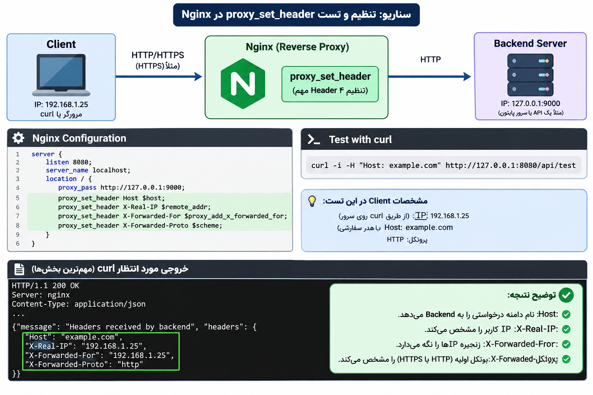

# Intro to proxy_set_header
---
### بریم اول درمورد یه موضوع مهم صحبت کنیم که هدر چیست:

ا-Headerها اطلاعاتی هستند که همراه درخواست یا پاسخ HTTP منتقل می‌شوند و به طرف مقابل کمک می‌کنند درخواست یا پاسخ را بهتر بشناسد و پردازش کند.

مثلاً اطلاعاتی درباره:

- ا-Source (مبدأ): مثل IP فرستنده یا اطلاعات پروتکل.
    
- ا-Destination (مقصد): مثل نام دامنه یا Host مقصد.
    
- نوع محتوا: مثل `Content-Type`.
    
- نحوه انتقال: مثل `Content-Length`.
    
- اطلاعات واسطه‌ها: مثل `X-Forwarded-For`.

---

# ۱. `proxy_set_header` چیست؟

دستور `proxy_set_header` در Nginx برای تنظیم یا تغییر HTTP Headerهایی استفاده می‌شود که Nginx هنگام ارسال درخواست به سرور Backend می‌فرستد.

ساختار کلی:

```
proxy_set_header HEADER_NAME VALUE;
```

مثلاً:

```
proxy_set_header Host $host;
```

یعنی Nginx هنگام ارسال درخواست به Backend، مقدار Header به نام `Host` را برابر مقدار متغیر `$host` قرار بدهد.

یک نکته بسیار مهم:

در ارتباط بین Client و Nginx و سپس Nginx و Backend، دو درخواست جداگانه داریم:

Client (مرورگر کاربر)

درخواست HTTP اولیه

Nginx (Reverse Proxy)

proxy_set_header

Headerهای درخواست خروجی را تنظیم می‌کند

Backend Server

درخواست HTTP دریافت‌شده از Nginx

پس `proxy_set_header` روی Headerهای درخواست ارسالی از Nginx به Backend اثر می‌گذارد، نه روی Headerهای پاسخ Backend به Client.

# ۲. انواع مهم `proxy_set_header`

در واقع `proxy_set_header` خودش یک Directive است و مدل‌های مختلف ندارد؛ بلکه می‌توانیم Headerهای مختلفی را با آن تنظیم کنیم.

این جدول مهم‌ترین مواردی است که باید یاد بگیری:

|Header|کاربرد|
|---|---|
|`Host`|انتقال نام دامنه درخواست‌شده|
|`X-Real-IP`|ارسال IP کلاینتی که مستقیماً به Nginx متصل شده|
|`X-Forwarded-For`|نگهداری زنجیره IPهای عبوری|
|`X-Forwarded-Proto`|مشخص‌کردن پروتکل درخواست اولیه، مثل HTTP یا HTTPS|
|`X-Forwarded-Host`|انتقال Host اصلی درخواست|
|`X-Forwarded-Port`|انتقال پورت درخواست اولیه|

## بررسی چهار Header اصلی

### الف) Host

```
proxy_set_header Host $host;
```

فرض کن کاربر وارد این آدرس شده:

```
https://example.com/products
```

درخواست به Nginx می‌رسد.

متغیر `$host` نام دامنه درخواست را در اختیار Nginx می‌گذارد.

بنابراین Backend این Header را دریافت می‌کند:

```
Host: example.com
```

چرا مهم است؟ چون ممکن است Backend چندین وب‌سایت یا Virtual Host داشته باشد و بر اساس Host تشخیص دهد درخواست مربوط به کدام سایت است.

### ب) X-Real-IP

```
proxy_set_header X-Real-IP $remote_addr;
```

فرض کن IP کلاینت این باشد:

```
192.168.1.25
```

Nginx این Header را به Backend می‌فرستد:

```
X-Real-IP: 192.168.1.25
```

در نتیجه Backend می‌تواند IP اتصال‌دهنده به Nginx را ببیند.

نکته: اگر قبل از Nginx یک Load Balancer یا Proxy دیگر وجود داشته باشد، `$remote_addr` ممکن است IP همان واسطه باشد، نه IP واقعی کاربر.

### ج) X-Forwarded-For

```
proxy_set_header X-Forwarded-For $proxy_add_x_forwarded_for;
```

این Header برای نگهداری زنجیره IPهای عبوری استفاده می‌شود.

مثلاً:

```
X-Forwarded-For: 192.168.1.25, 10.0.0.5
```

متغیر `$proxy_add_x_forwarded_for` معمولاً IP اتصال‌دهنده فعلی به Nginx را به مقدار قبلی `X-Forwarded-For` اضافه می‌کند.

توجه کن که مقدار قبلی ممکن است توسط Client جعل شده باشد؛ پس Backend نباید بدون پیکربندی اعتماد، هر IP موجود در این Header را معتبر بداند.

### د) X-Forwarded-Proto

```
proxy_set_header X-Forwarded-Proto $scheme;
```

فرض کن کاربر با HTTPS وارد شده:

```
https://example.com
```

Nginx این Header را ارسال می‌کند:

```
X-Forwarded-Proto: https
```

اگر درخواست با HTTP باشد:

```
X-Forwarded-Proto: http
```

این اطلاعات برای ساخت لینک‌های صحیح، Redirect و تشخیص ارتباط امن در Backend کاربرد دارد.

نکته: اگر TLS قبل از Nginx و روی یک Load Balancer خاتمه پیدا کند، `$scheme` ممکن است `http` باشد، حتی اگر کاربر از HTTPS استفاده کرده باشد.

# ۳. دلیل استفاده از `proxy_set_header` چیست؟

شاید بپرسی چرا اصلاً باید Headerها را تغییر بدهیم؟ مگر Nginx خودش درخواست را به Backend نمی‌فرستد؟

درست است، اما Backend همیشه به اطلاعاتی نیاز دارد که در درخواست اولیه وجود داشته یا در مسیر انتقال باید مشخص شوند.

مهم‌ترین دلایل:

|دلیل|توضیح|
|---|---|
|تشخیص IP کاربر|Backend بتواند IP اتصال‌دهنده به Nginx را دریافت کند|
|تشخیص دامنه|Backend بداند درخواست برای کدام دامنه است|
|تشخیص HTTP یا HTTPS|برنامه بتواند پروتکل اولیه را تشخیص دهد|
|مدیریت Redirect|برنامه بتواند لینک و آدرس مناسب تولید کند|
|ثبت لاگ دقیق|اطلاعات درخواست در لاگ‌های Backend کامل‌تر باشد|
|امنیت و کنترل دسترسی|برنامه بتواند اطلاعات لازم برای سیاست‌های امنیتی را دریافت کند|

### یک مثال واقعی

فرض کن معماری سایت تو این‌طور است:

```
User
  |
  | HTTPS
  |
  v
Nginx
  |
  | HTTP
  |
  v
Backend (127.0.0.1:9000)
```

کاربر با HTTPS وارد سایت شده، اما Nginx برای ارتباط داخلی با Backend از HTTP استفاده می‌کند.

اگر Backend نداند درخواست اولیه HTTPS بوده، ممکن است لینک‌های اشتباه بسازد یا Redirect نامناسب انجام دهد.

با این دستور:

```
proxy_set_header X-Forwarded-Proto $scheme;
```

ا-Backend متوجه می‌شود درخواست اولیه با چه پروتکلی به Nginx رسیده است.

نکته: در تنظیمات پیش‌فرض Nginx، بیشتر Headerهای درخواست Client به Backend منتقل می‌شوند. بنابراین لازم نیست همه Headerها را دوباره تعریف کنیم. `proxy_set_header` برای تنظیم Headerهای مشخصی است که می‌خواهیم تغییر بدهیم یا مقدارشان را تعیین کنیم.

---
### 4-بریم سراغه تست انواع proxy_set_header هایه مختلف

<p align=center>
	
</p>

توضیح هر کدوم رو در بخش خودشون میگم
