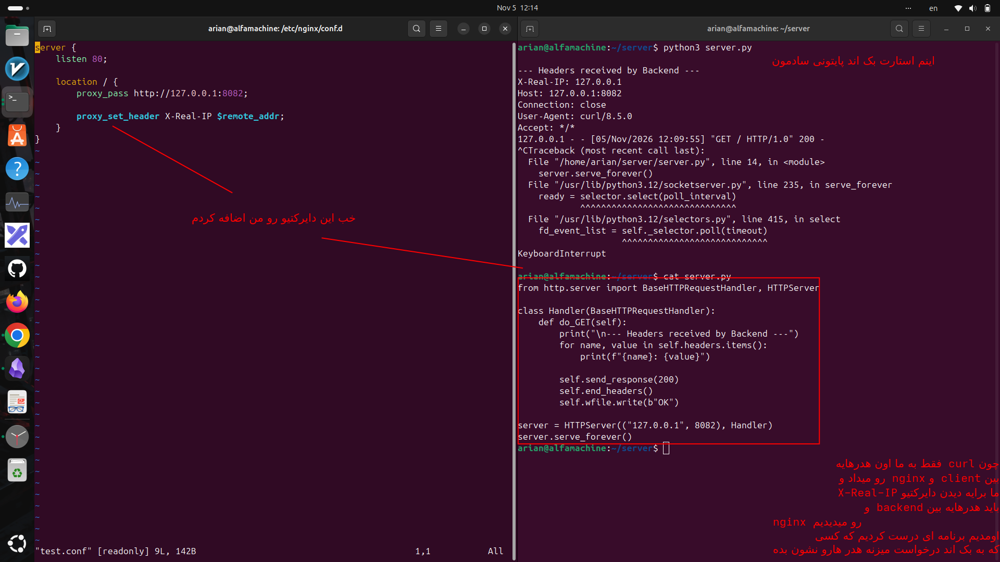

# proxy_set_header X-Real-IP $remote_addr;
---
## 1-این دایرکتیو چیست:
دستور `X-Real-IP` یک هدر HTTP است که IP واقعی کلاینت را به سرور بک‌اند منتقل می‌کند تا بک‌اند بتواند تشخیص دهد درخواست از طرف چه IPای ارسال شده است.

---

## 2-محل قرار گیری این دایرکتیو کجاست

این دستور داخل بلاک `location` و در کنار `proxy_pass` قرار می‌گیرد.

مثال:

```c
server {
    listen 80;

    location / {
        proxy_pass http://127.0.0.1:8082;

        proxy_set_header Host $host;
        proxy_set_header X-Real-IP $remote_addr;
    }
}
```

یعنی هر درخواستی که از این `location` به بک‌اند فرستاده می‌شود، هدر `X-Real-IP` هم همراهش ارسال می‌شود.

---
### 3- شما به کمک دستور curl نمیتونید بخش هدر هایه کلاینت و بک اند رو ببینید چون دستور curl هدر هایه ارتباطی بین nginx و client رو نشون میده 
- راه حل اگر میخواهید خودتان تست کنید :
- من اومدم با پایتون برایه سرور پایتونیم یه خطوطی نوشتم که درخواست میزند اون هدر هایه بین nginx و backend رو نشون میده و میتونیم حالا ببینیم که این دایرکتیو چی دراد

<p align=center>
	
</p>

