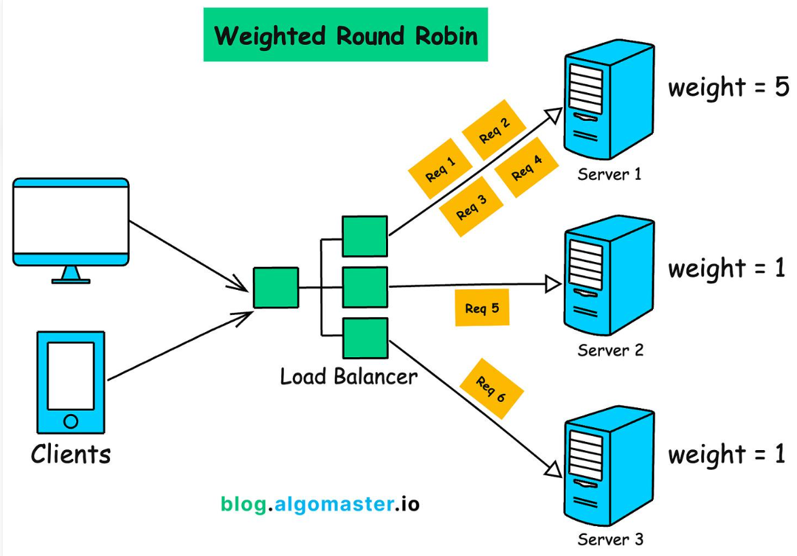

# weight parameter for server directive and upstream block

---
## ۱-پارامتر weight  چیست و در کجا قرار دارد و در کدام بلاک و دایرکتیو تعریف میشه:

<p align=center>
	
</p>


ا-`weight` پارامترِ Directive به نام `server` است که داخل بلاک `upstream` قرار می‌گیرد.

یعنی ساختار به این شکل است:

```
upstream backend {

    server 192.168.1.10:80 weight=5;
    server 192.168.1.11:80 weight=3;
    server 192.168.1.12:80 weight=1;

}
```

دسته‌بندی دقیق:

| عبارت      | نوع                       |
| ---------- | ------------------------- |
| `upstream` | Block Directive           |
| `server`   | Directive                 |
| `weight`   | Parameter مربوط به server |

---


## ۲- این پارامتر چیکار میکند برایه ما:

با پارامتر `weight` می‌توانیم میزان سهم هر Backend Server از درخواست‌های ورودی را کنترل کنیم.

یعنی اگر چند سرور قدرت پردازشی متفاوتی داشته باشند، می‌توانیم مشخص کنیم هرکدام چه نسبتی از درخواست‌ها را دریافت کنند.

 - ا-<mark>۱. تعیین وزن برای هر سرور</mark>

فرض کن سه Backend Server داریم:

```
upstream backend {

    server 192.168.1.10:80 weight=5;
    server 192.168.1.11:80 weight=3;
    server 192.168.1.12:80 weight=1;

}
```

در این مثال:

- سرور اول وزن ۵ دارد.
    
- سرور دوم وزن ۳ دارد.
    
- سرور سوم وزن ۱ دارد.
    

- ا-<mark> ۲. تقسیم درخواست‌ها بر اساس وزن</mark>

<p align=center>
	
</p>

در مجموع وزن‌ها برابر است با:

\[ 5+3+1=9 \]

بنابراین توزیع مورد انتظار درخواست‌ها در بلندمدت:

|سرور|سهم تقریبی|
|---|---|
|Server 1|55.5%|
|Server 2|33.3%|
|Server 3|11.1%|

---
## ۳. چه کارهایی با weight می‌توانیم انجام دهیم؟

1. اولویت‌بندی سرورها: سرور قوی‌تر سهم بیشتری از درخواست‌ها دریافت کند.
    
2. توزیع نامساوی بار: درخواست‌ها الزاماً به‌صورت مساوی تقسیم نشوند.
    
3. استفاده از ظرفیت سرورها: از سرورهای قدرتمندتر سهم بیشتری بگیریم.
    
4. تنظیم انعطاف‌پذیر ترافیک: با تغییر وزن‌ها، نسبت توزیع درخواست‌ها را تغییر دهیم.
    

---

## ۴. یک نکته مهم

پارامتر `weight` به‌تنهایی ظرفیت واقعی سرور را تشخیص نمی‌دهد. یعنی Nginx نمی‌فهمد کدام سرور CPU قوی‌تری دارد؛ ما باید بر اساس شناختی که از سرورها داریم، وزن مناسب را تعیین کنیم.

همچنین در الگوریتم پیش‌فرض Round Robin، این وزن‌ها اعمال می‌شوند و در الگوریتم‌هایی مثل `least_conn` نیز وزن می‌تواند در انتخاب سرور مؤثر باشد.
