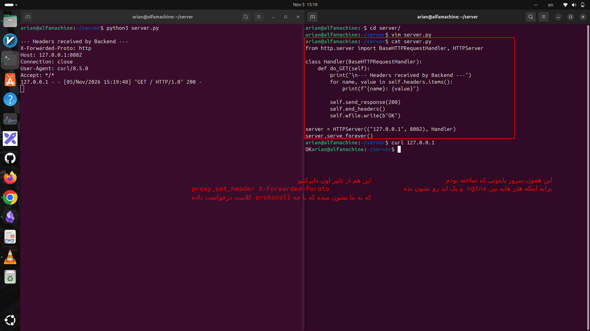

# Proxy_set_header X-Forwarded-Proto
---
### 1-این دایرکتیو چیست Proxy_set_header X-Forwarded-Proto:


هدر `X-Forwarded-Proto` به بک‌اند می‌گوید که کلاینت با چه پروتکلی به Nginx وصل شده است: HTTP یا HTTPS.

---
### 2. محل قرارگیری کجاست؟

در کانفیگ Nginx و داخل بلوک `location` قرار می‌گیرد؛ کنار بقیه دستورهای `proxy_set_header`.

مثلاً:

```
server {
    listen 80;

    location / {
        proxy_pass http://127.0.0.1:8082;

        proxy_set_header Host $host;
        proxy_set_header X-Real-IP $remote_addr;
        proxy_set_header X-Forwarded-For $proxy_add_x_forwarded_for;
        proxy_set_header X-Forwarded-Proto $scheme;
    }
}
```

یعنی Nginx هنگام ارسال درخواست به بک‌اند، این هدرها را هم به درخواست اضافه می‌کند.

---

### ۳-  چه چیزی را نشان می‌دهد؟

مشخص می‌کند که کلاینت برای اتصال به Nginx از چه پروتکلی استفاده کرده است.

مثلاً:

- کاربر با HTTP وارد شده باشد:

```
X-Forwarded-Proto: http
```

- کاربر با HTTPS وارد شده باشد:

```
X-Forwarded-Proto: https
```

نکته مهم: این هدر پروتکل ارتباط کلاینت با Nginx را نشان می‌دهد، نه پروتکل ارتباط Nginx با بک‌اند.

---
### ۴- ساختارش به چه صورت است؟

```
X-Forwarded-Proto: https
```

اجزای آن:

|بخش|مفهوم|
|---|---|
|`X-Forwarded-Proto`|نام هدر|
|`https`|مقدار هدر|

در Nginx هم:

```
proxy_set_header X-Forwarded-Proto $scheme;
```

- ا-`proxy_set_header`: تنظیم هدر ارسالی به بک‌اند
    
- ا-`X-Forwarded-Proto`: نام هدر
    
- ا-`$scheme`: پروتکل درخواست ورودی به Nginx

---

### ۵- چرا این هدر مهم است؟

فرض کن:

1. کاربر با HTTPS به Nginx وصل می‌شود.
    
2. ا-Nginx درخواست را با HTTP به بک‌اند می‌فرستد.
    
3. بک‌اند ممکن است فکر کند کاربر با HTTP وارد شده است.
    

با استفاده از `X-Forwarded-Proto`، بک‌اند متوجه می‌شود که ارتباط اولیه کاربر HTTPS بوده است.

این موضوع برای ساخت لینک‌های صحیح، تشخیص اتصال امن و مدیریت ریدایرکت‌ها کاربرد دارد.

یک نکته امنیتی: بک‌اند باید فقط به هدرهای ارسالی از پراکسی مورد اعتماد خودش اعتماد کند؛ چون کلاینت می‌تواند هدر جعلی ارسال کند

جمع‌بندی کوتاه:

- ا-<mark> `X-Forwarded-Proto` به بک‌اند می‌گوید درخواست اولیه کلاینت با `http` بوده یا `https`. </mark> 

---
### 6- اینجا هم ما میایم تست میکنیم که به چه صورته این دایرکتیو و سرورمون هم همون سرور کی کد هاشو زده بودیم  


<p align=center>
	
</p>

