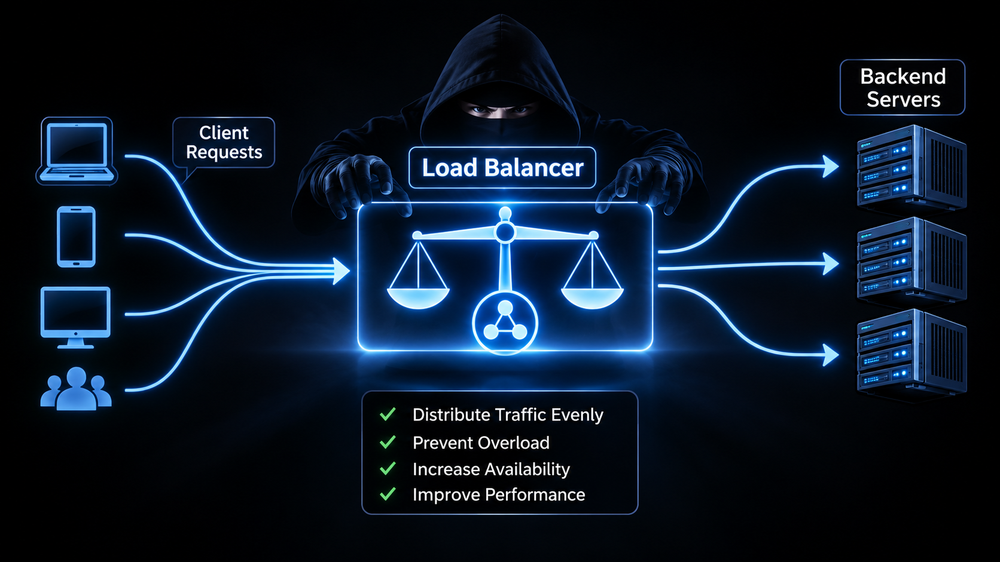
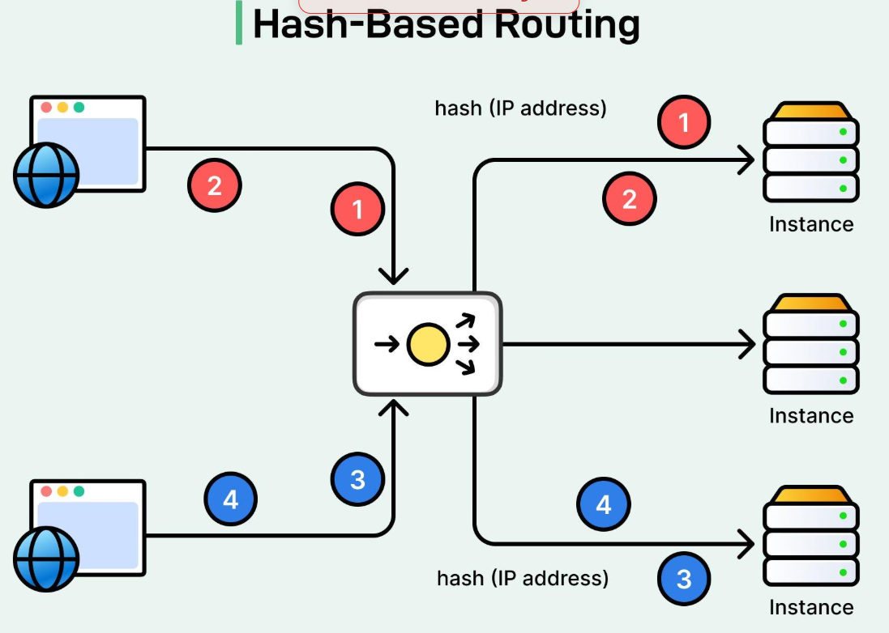

# Intro to load balancing
## چیزایی که قراره یاد بگیریم:

---
### 1-اصلا load balancing که میگن چی هست:

<p align=center>
	
</p>

-همان‌طور که در تصویر بالا مشاهده می‌کنید، `Load Balancing` به این معناست که ترافیک و درخواست‌های ورودی به وب‌سرور را بر اساس یک الگوریتم مشخص، بین چندین `Backend Server` توزیع کنیم.

برای مثال، یکی از الگوریتم‌های قابل استفاده، `Weighted Round Robin` است که درخواست‌ها را با توجه به وزن تعیین‌شده برای هر سرور تقسیم می‌کند.

هدف از این کار:

- جلوگیری از Overload: جلوگیری از وارد شدن فشار بیش از ظرفیت به یک سرور.
    
- افزایش High Availability: افزایش دسترس‌پذیری سرویس، به‌خصوص در صورت خرابی یکی از سرورها.
    
- بهبود Performance: بهبود عملکرد و پاسخ‌گویی سرویس از طریق توزیع مناسب بار کاری.

---
### 2-الگوریتم هایه مبحث Load balancing
- ا-<mark>1-Round Robin</mark>

<p align=center>
	
</p>

در این روش درخواست‌ها به‌صورت نوبتی بین سرورها تقسیم می‌شوند.
در اینجا کامل توضیح دادم:
[roundrobin](../1-terms-and-architecture/load-balancing/01-Round-Robin.md)

فرض کن سه سرور داریم:

- Server 1
    
- Server 2
    
- Server 3
    

تقسیم درخواست‌ها به این شکل خواهد بود:

|درخواست|سرور مقصد|
|---|---|
|Request 1|Server 1|
|Request 2|Server 2|
|Request 3|Server 3|
|Request 4|Server 1|
|Request 5|Server 2|
|Request 6|Server 3|

یعنی هر سرور به نوبت درخواست دریافت می‌کند.

- ا-<mark> Weighted Round Robin-2</mark>

<p align=center>
	
</p>

در این روش برخلاف Round Robin ساده، همه سرورها سهم یکسانی از درخواست‌ها دریافت نمی‌کنند.

ما برای هر سرور یک Weight تعیین می‌کنیم.

مثلاً:

|سرور|Weight|
|---|---|
|Server 1|5|
|Server 2|3|
|Server 3|1|

یعنی در یک چرخه ۹ درخواستی، به‌صورت ایده‌آل:

- سرور اول: ۵ درخواست
    
- سرور دوم: ۳ درخواست
    
- سرور سوم: ۱ درخواست
    

در Nginx:

```
upstream backend {
    server 192.168.1.10 weight=5;
    server 192.168.1.11 weight=3;
    server 192.168.1.12 weight=1;
}
```

کاربرد: زمانی که قدرت سخت‌افزاری سرورها با یکدیگر متفاوت است.

- ا-<mark>3-Least connectinos</mark>

<p align=center>
	
</p>

در این روش Nginx درخواست جدید را به سروری می‌فرستد که کمترین تعداد Connection فعال را دارد.

مثلاً:

|سرور|اتصال فعال|
|---|---|
|Server 1|20|
|Server 2|5|
|Server 3|12|

درخواست جدید به Server 2 ارسال می‌شود.

در Nginx:

```
upstream backend {
    least_conn;

    server 192.168.1.10;
    server 192.168.1.11;
    server 192.168.1.12;
}
```

کاربرد: زمانی که مدت‌زمان پردازش درخواست‌ها متفاوت است و نمی‌توان صرفاً با نوبتی تقسیم کردن، بار را متعادل کرد.

- ا-<mark>4-Ip Hash</mark>

<p align=center>
	
</p>
در این روش Nginx از IP کاربر برای انتخاب سرور Backend استفاده می‌کند.

مثلاً:

- ا-User A با IP مشخص به Server 1 هدایت می‌شود.
    
- ا-User B با IP متفاوت به Server 2 هدایت می‌شود.
    
- اگر User A دوباره درخواست بفرستد، معمولاً مجدداً به Server 1 هدایت می‌شود.
    

در Nginx:

```
upstream backend {
    ip_hash;

    server 192.168.1.10;
    server 192.168.1.11;
    server 192.168.1.12;
}
```

کاربرد: زمانی که می‌خواهیم درخواست‌های یک کاربر تا حد امکان به یک سرور مشخص هدایت شوند.

نکته: این روش به‌تنهایی تضمین‌کننده Session Persistence کامل نیست.

 
 - ا-<mark>5-hash</mark>


در این روش می‌توانیم بر اساس یک کلید مشخص، سرور مقصد را انتخاب کنیم.

مثلاً کلید می‌تواند یکی از موارد زیر باشد:

- IP Address
    
- User ID
    
- URL
    
- نام دامنه
    

در Nginx:

```
upstream backend {
    hash $request_uri;

    server 192.168.1.10;
    server 192.168.1.11;
    server 192.168.1.12;
}
```

در این مثال، درخواست‌هایی با URI یکسان معمولاً به یک سرور مشخص هدایت می‌شوند.

کاربرد: توزیع پایدار درخواست‌ها بر اساس یک کلید مشخص، مثلاً برای Cache کردن محتوا

- ا-<mark>6-random</mark>

<p align=center>
	
</p>

در این روش Nginx به‌صورت تصادفی یکی از سرورهای Backend را انتخاب می‌کند.

در Nginx:

```
upstream backend {
    random;

    server 192.168.1.10;
    server 192.168.1.11;
    server 192.168.1.12;
}
```

یک حالت پیشرفته‌تر هم داریم:

```
random two least_conn;
```

در این حالت Nginx دو سرور را به‌صورت تصادفی انتخاب می‌کند و از بین آن‌ها سروری را که Connection کمتری دارد انتخاب می‌کند.

---
## ۳-مقایسه این الگوریتم ها


|الگوریتم|معیار انتخاب سرور|
|---|---|
|Round Robin|نوبت|
|Weighted Round Robin|وزن سرور|
|Least Connections|تعداد اتصال فعال|
|IP Hash|آدرس IP کاربر|
|Hash|کلید مشخص|
|Random|انتخاب تصادفی|
|Random Two Least Conn|انتخاب بهتر از بین دو سرور تصادفی|

## کدام‌ها را برای Nginx باید یاد بگیری؟

پیشنهاد من این ترتیب است:

## نقشه یادگیری Load Balancing

1. Round Robin
    
    پایه و منطق تقسیم نوبتی درخواست‌ها
    
2. Weighted Round Robin
    
    تقسیم درخواست‌ها با وزن متفاوت
    
3. Least Connections
    
    توزیع بر اساس Connectionهای فعال
    
4. IP Hash و Hash
    
    آشنایی با Session Persistence و توزیع مبتنی بر کلید
    
5. Random و Random Two
    
    انتخاب تصادفی و انتخاب هوشمندتر
    

یک نکته فنی مهم: در Nginx علاوه بر این الگوریتم‌ها، باید با Directiveهای مربوط به مدیریت سرورهای Backend مثل `backup`، `max_fails` و `fail_timeout` هم آشنا شوی. این‌ها الگوریتم توزیع نیستند، بلکه به مدیریت خرابی و دسترس‌پذیری کمک می‌کنند.
