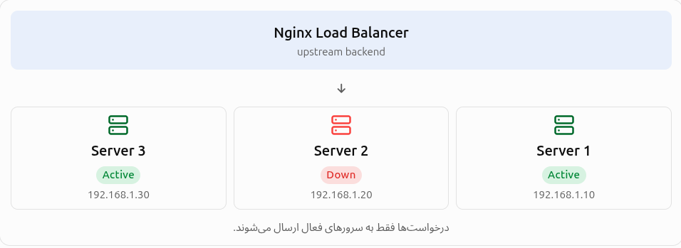

# Down parameter 
this parameter use in the load balancing and infront of the 
server directive as parameter

---
## ۱-این دایرکتیو چیست و برایه چی استفاده میشه :

وقتی کنار یک سرور از پارامتر `down` استفاده می‌کنیم، به Nginx می‌گوییم:

این سرور را در نظر داشته باش، اما درخواست‌های جدید را به آن ارسال نکن.

یا :

«من می‌دونم این سرور وجود داره و می‌خوام توی تنظیماتم باقی بمونه، اما فعلاً خاموشش در نظر بگیر و هیچ درخواستی براش نفرست.»

---
## ۲- بریم سرغه ساختار پارامتر down و این که در کجا قرار میگیرد و به چه صورته:
#### ساختار (Syntax)

```
server IP_ADDRESS:PORT down;
```

مثلاً:

```
server 192.168.1.20:8080 down;
```

در این ساختار:

- ا-`server`: معرفی یک Backend Server
    
- `192.168.1.20`: آدرس IP سرور
    
- `8080`: پورتی که سرویس Backend روی آن اجرا می‌شود.
    
- ا-`down`: خارج کردن سرور از چرخه توزیع بار

## کجا استفاده می‌شود؟

دستور `down` داخل بلاک `upstream` استفاده می‌شود.

یعنی در بخش تعریف سرورهای Backend، نه داخل `server` اصلی Nginx و نه داخل `location`.

مثال:

```
http {

    upstream backend {
        server 192.168.1.10:8080;
        server 192.168.1.20:8080 down;
        server 192.168.1.30:8080;
    }

    server {
        listen 80;

        location / {
            proxy_pass http://backend;
        }
    }
}
```

---
## ۳- برایه چی اصلا ما از این ساختار استفاده میکنیم:


از پارامتر `down` در شرایط زیر استفاده می‌کنیم:

1. تعمیر و نگهداری سرور: خارج کردن موقت سرور از چرخه توزیع بار هنگام تعمیرات.
    
2. به‌روزرسانی سرور: جلوگیری از ارسال درخواست به سرور هنگام نصب نسخه جدید نرم‌افزار.
    
3. رفع مشکلات فنی: خارج کردن دستی سروری که دچار مشکل شده تا بررسی و عیب‌یابی شود.
    
4. تغییر تنظیمات سرور: جلوگیری از دریافت ترافیک هنگام اعمال تغییرات زیرساختی.
    
5. آماده‌سازی برای راه‌اندازی مجدد: خارج کردن سرور از چرخه درخواست‌ها تا عملیات Restart یا Reconfiguration انجام شود.
    
6. مدیریت ترافیک: جلوگیری از ارسال درخواست‌های جدید به یک Backend مشخص، بدون حذف تعریف آن از تنظیمات Nginx.
    

نتیجه: با استفاده از `down` می‌توانیم یک سرور را در تنظیمات نگه داریم، اما تا زمان نیاز، آن را از چرخه توزیع بار خارج کنیم.

---
#### جمع بندی توضیحش

- ما از این دایرکتیو استفاده میکنیم تا اینکه سروری وجودش تایید باشه ولی ترافیکی ازش رد نشه و پردازه ای انجام نده:

<p align=center>
	
</p>

