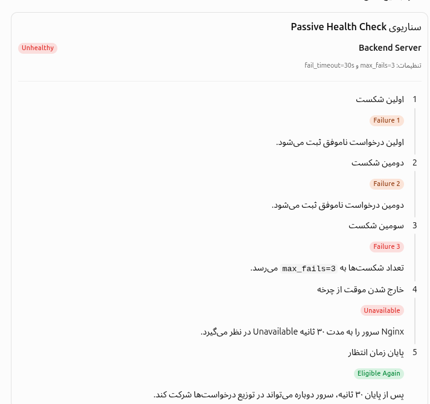

# Max_fails and fail_timeout
---
## ۱- اول این پارامترها چین و چرا پشت هم گذاشتمشون

این دو پارامتر مکمل هم دیگر هستند و با همدیگه استفاده میشوند و اینکه  یکیشون و یکی دیگر مشخص میکنه که به اندازه اون تعداد شکستی که خورد چند ثانیه خوده اون سرور از کار بیوفته.

|Directive|وظیفه|
|---|---|
|`max_fails`|تعیین آستانه تعداد شکست‌ها|
|`fail_timeout`|تعیین بازه شمارش شکست‌ها و مدت Unavailable بودن سرور|

نکته فنی مهم برای یادگیری: در Nginx Open Source، این رفتار برای گروهی از سرورهای معمولی Upstream معنا دارد. اگر فقط یک سرور در گروه وجود داشته باشد، یا سرورها با `backup` یا `down` تنظیم شده باشند، رفتار متفاوتی وجود دارد. همچنین پایان `fail_timeout` به معنای تست سلامت قطعی سرور نیست؛ Nginx صرفاً دوباره اجازه استفاده از آن را می‌دهد و Passive Health Check با درخواست‌های واقعی ادامه پیدا می‌کند.

---

## ۲- در کجا استفاده میشن این دوبرادر و اینکه چه ساختاری دارند

این دو پارامتر داخل دستور `server` در بلوک `upstream` تعریف می‌شوند.

ساختار کلی:

- ا-<mark>اگر درون فایل etc/nginx/nginx.conf این چیزی که میگم بود </mark>
- include /etc/nginx/conf.d/*.conf;
- include /etc/nginx/sites-enabled/*;
دیگه نیازی نیست که شما بیاید و دوباره اون upstream block رو درون http block بزارید چون ما درون etc/nginx/conf.d/ مینویسیم فایل هامون رو و include  میشه درون http  که درون فایل config اصلی etc/nginx/nginx.conf/

```
http {

    upstream backend_servers {

        server 192.168.1.10:8080
            max_fails=3
            fail_timeout=30s;

        server 192.168.1.11:8080
            max_fails=3
            fail_timeout=30s;

    }

}
```

در این ساختار:

- ا-`upstream`: مجموعه Backend Serverها را تعریف می‌کند.
    
- ا-`server`: آدرس و پورت هر Backend Server را مشخص می‌کند.
    
- ا-`max_fails`: تعداد شکست‌های مجاز را مشخص می‌کند.
    
- ا-`fail_timeout`: بازه زمانی شمارش شکست‌ها و مدت Unavailable بودن سرور را مشخص می‌کند.

---
## ۳-حالا بریم سراغه توضیحات تک تک این پارامتر 
# ۳-۱پارامتر max_fails

تعریف:

پارامتر `max_fails` مشخص می‌کند که چند بار تلاش ناموفق برای ارتباط با یک Backend Server باید اتفاق بیفتد تا Nginx آن سرور را Unavailable در نظر بگیرد.

به عبارت ساده:

`max_fails = Failure Threshold`

یعنی آستانه تعداد شکست‌ها.

مثلاً:

```
server 192.168.1.10:8080 max_fails=3;
```

یعنی اگر تعداد شکست‌های معتبر به ۳ برسد، Nginx سرور را موقتاً Unavailable در نظر می‌گیرد.

چند مقدار متداول:

| مقدار         | عملکرد                     |
| ------------- | -------------------------- |
| `max_fails=1` | یک شکست کافی است           |
| `max_fails=2` | دو شکست لازم است           |
| `max_fails=3` | سه شکست لازم است           |
| `max_fails=5` | پنج شکست لازم است          |
| `max_fails=0` | غیرفعال کردن شمارش شکست‌ها |
|               |                            |

نکته: منظور از شکست، هر پاسخ HTTP ناموفق نیست.<mark> معیار شکست به تنظیمات `proxy_next_upstream` و نوع خطا بستگی دارد.</mark>

# 3-2پارامتر fail_timeout

این پارامتر دو وظیفه مهم دارد:

وظیفه اول: Failure Detection Window

مشخص می‌کند شکست‌ها در چه بازه زمانی شمارش شوند.

وظیفه دوم: Unavailable Duration

مشخص می‌کند بعد از رسیدن به تعداد شکست‌های تعیین‌شده، سرور چه مدت Unavailable در نظر گرفته شود.

مثلاً:

```
server 192.168.1.10:8080 fail_timeout=30s;
```

یعنی بازه زمانی مورد استفاده برای شمارش شکست‌ها و مدت Unavailable در نظر گرفتن سرور، ۳۰ ثانیه است.

---
## ۴-یه مثال که ترکیب این دوتا رو نشون بده

# ترکیب max_fails و fail_timeout

حالا می‌رسیم به قسمت مهم ماجرا؛ جایی که این دو پارامتر در کنار یکدیگر معنا پیدا می‌کنند.

فرض کن تنظیمات ما به شکل زیر باشد:

```
upstream backend_servers {

    server 192.168.1.10:8080
        max_fails=3
        fail_timeout=30s;

}
```

عملکرد به این شکل است:

<p align=center>
	
</p>

---

# 6. در نهایت، چرا از این دو پارامتر استفاده می‌کنیم؟

هدف اصلی استفاده از این دو پارامتر، افزایش پایداری و دسترس‌پذیری سرویس است.

به کمک آن‌ها:

1. ا-Nginx می‌تواند Backend Serverهای مشکل‌دار را شناسایی کند.
    
2. از ارسال مکرر درخواست به سرورهای مشکل‌دار جلوگیری می‌شود.
    
3. درخواست‌های کاربران می‌توانند به Backend Serverهای سالم هدایت شوند.
    
4. به سرور مشکل‌دار فرصت داده می‌شود تا دوباره به وضعیت عادی برگردد.

---

## 7-و نکته ی اخر :
وقتی میخواید max_fails تعریف کنید یک proxy_next_upstream هم تعریف کنید که مبنا fail  خوردن رو بر اساسی که میخواید تعیین کند و حالا درمورد proxy_next_upstream هم صحبت میکنیم در فایل هایه بعدی و 
اینو یادتون باشه که http رو خوب مطالعه کنید مخصوصا برای این قسمت HTTP status code هارو:

## دسته‌بندی HTTP Status Codeها

| محدوده | دسته          | مفهوم                  |
| ------ | ------------- | ---------------------- |
| 1xx    | Informational | پاسخ‌های اطلاع‌رسانی   |
| 2xx    | Success       | درخواست موفق           |
| 3xx    | Redirection   | تغییر مسیر             |
| 4xx    | Client Error  | خطای درخواست یا کلاینت |
| 5xx    | Server Error  | خطای سرور              |

‍`

```
upstream backend_servers {

    server 192.168.1.10:8080
        max_fails=3
        fail_timeout=30s;

    server 192.168.1.11:8080
        max_fails=3
        fail_timeout=30s;
}

server {

    location / {

        proxy_pass http://backend_servers;

        proxy_next_upstream error timeout http_500 http_502 http_503 http_504;

    }
}
```
