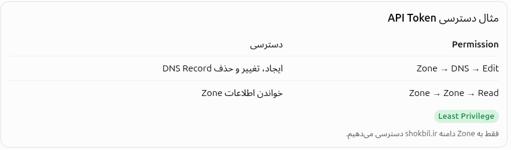

# Section 10 Requirements
---
## ۱. Certbot چیست؟

- ا-Certbot یک نرم‌افزار (ACME Client) است که روی سیستم‌عامل لینوکسی خودمان نصب می‌کنیم.
    
- وظیفه آن درخواست دریافت SSL/TLS Certificate از یک مرجع صدور گواهی (CA) مانند Let's Encrypt است.
    
- فرایند اعتبارسنجی دامنه و دریافت Certificate را مدیریت می‌کند.
    
- ا-Private Key را روی سیستم خودمان تولید و نگهداری می‌کند.
    
- امکان تمدید خودکار Certificate را فراهم می‌کند.
    

نکته مهم:

- ا-Let's Encrypt = صادرکننده Certificate
    
- ا-Certbot = درخواست‌کننده و مدیریت‌کننده Certificate

---

# ۲. API چیست؟

API مخفف Application Programming Interface است.

یعنی رابط برنامه‌نویسی کاربردی.

فرض کن وارد پنل Cloudflare می‌شوی و یک DNS Record می‌سازی.

برای این کار معمولاً وارد سایت می‌شوی، دکمه Add Record را می‌زنی و اطلاعات را وارد می‌کنی.

اما فرض کن بخواهی یک برنامه مثل Certbot بدون دخالت انسان همین کار را انجام دهد.

آیا باید مرورگر را باز کند و دکمه‌ها را کلیک کند؟

خیر!

اینجا API وارد می‌شود.

ا-API به نرم‌افزارها اجازه می‌دهد از طریق درخواست‌های مشخص با یک سرویس دیگر ارتباط برقرار کنند.

مثلاً:

```
Certbot
   |
   | API Request
   |
   v
Cloudflare API
   |
   | Create DNS Record
   |
   v
Cloudflare DNS
```

یعنی Certbot می‌تواند به Cloudflare درخواست بدهد:

«لطفاً یک TXT Record برای دامنه من ایجاد کن.»

ا-Cloudflare هم درخواست را پردازش می‌کند.

---
# ۳. API Token چیست؟

حالا یک سؤال مهم:

ا-Cloudflare از کجا بفهمد برنامه‌ای که به API درخواست می‌دهد، اجازه تغییر DNS دامنه ما را دارد؟

اینجا API Token استفاده می‌شود.

ا-API Token در واقع یک اعتبارنامه محرمانه برای احراز هویت و اعطای مجوز به درخواست‌های API است.

مثلاً فرض کن به Certbot اجازه می‌دهیم:

- ا-DNS Record ایجاد کند.
    
- ا-DNS Record حذف کند.
    
- اطلاعات Zone دامنه را بخواند.
    

برای این کار در Cloudflare یک API Token می‌سازیم و مجوزهای لازم را به آن می‌دهیم.

<p align=center>
	
</p>
یک مثال ساده:

فرض کن Cloudflare یک ساختمان است:

- ا-API مثل در ورودی ارتباط نرم‌افزارهاست.
    
- ا-API Token مثل کارت دسترسی است.
    
- ا-Permission مشخص می‌کند کارت اجازه ورود به کدام قسمت‌ها را دارد.
    

نکته امنیتی: API Token را مثل رمز عبور محرمانه نگه دار. هرگز آن را در GitHub یا فایل‌های عمومی قرار نده.

---

# ۴. TXT Record چیست؟

حالا می‌رسیم به مهم‌ترین قسمت برای دریافت SSL.

ا-TXT مخفف Text Record است.

یکی از انواع DNS Record است که برای ذخیره اطلاعات متنی در DNS Zone استفاده می‌شود.

مثلاً:

```
Type: TXT

Name: example.com

Value: Hello-DNS
```

اما کاربرد مهم TXT برای پروژه ما چیست؟

اثبات مالکیت دامنه.

فرض کن می‌خواهی برای دامنه زیر SSL بگیری:

```
shokbil.ir
```

ا-Let's Encrypt باید مطمئن شود که واقعاً کنترل این دامنه را در اختیار داری.

برای اثبات این موضوع از روشی به نام DNS-01 Challenge استفاده می‌کنیم.

---
## ۵. DNS-01 Challenge چگونه کار می‌کند؟

فرض کن Certbot از Let's Encrypt درخواست Certificate می‌کند.

ا-Let's Encrypt یک مقدار تصادفی یا Token برای اعتبارسنجی در اختیار Certbot قرار می‌دهد.

ا-Certbot باید این مقدار را به‌صورت TXT Record در DNS دامنه قرار دهد.

مثلاً:

<p align=center>
	
</p>
حالا Let's Encrypt از DNS عمومی می‌پرسد:

«آیا این TXT Record با مقدار مورد انتظار من وجود دارد؟»

اگر مقدار صحیح باشد، مالکیت دامنه تأیید می‌شود و Certificate صادر خواهد شد.

نکته مهم: TXT Record فقط برای اثبات کنترل دامنه است؛ خودش Certificate نیست.

---
# ۶. ارتباط تمام این مفاهیم با یکدیگر

این قسمت را خوب یاد بگیر؛ چون هسته اصلی پروژه ماست.

<p align=center>
	
</p>
پس نقش هرکدام:

| مفهوم         | وظیفه                       |
| ------------- | --------------------------- |
| Certbot       | مدیریت دریافت و تمدید SSL   |
| API           | ارتباط برنامه با سرویس دیگر |
| API Token     | احراز هویت و مجوز دسترسی    |
| TXT Record    | اثبات کنترل دامنه           |
| Let's Encrypt | مرجع صدور Certificate       |

---
# ۷. چرا این روش برای پروژه ما مناسب است؟ (پروژما یعنی همین که ما میخوایم دامنه رو رویه ای پی محلی و localhost مون اجرا کنیم)

یک مزیت بسیار مهم DNS-01 وجود دارد:

برای دریافت Certificate نیازی نیست وب‌سرور تو از اینترنت قابل دسترسی باشد.

یعنی می‌توانیم:

- دامنه واقعی داشته باشیم.
    
- ا-DNS آن را روی Cloudflare مدیریت کنیم.
    
- ا-Certificate معتبر Let's Encrypt بگیریم.
    
- ا-Nginx را روی Ubuntu خودمان اجرا کنیم.
    
- بدون خرید VPS، HTTPS را روی localhost آزمایش کنیم.
    

برای اتصال دامنه به localhost بعداً از فایل `/etc/hosts` استفاده می‌کنیم.

---

