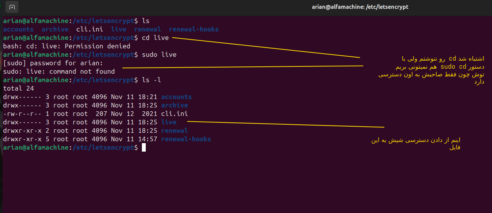
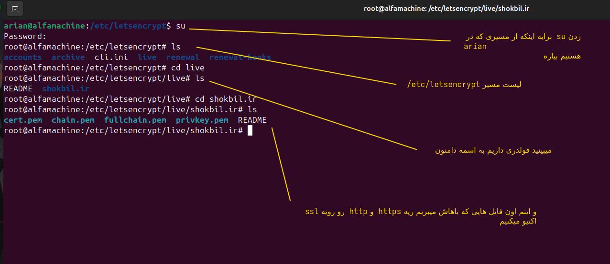

# پارت چهارم و اخرین پارت از خرید دامنه تا دریافت SSl certificate
### انچه گذشت درون این ۳ پارت گذشته
- ۱-خرید دامنه و احراز هوید درون هدا(هویت دیجیتال ایرانیان)
- ۲-رفتن درون cloudflare و دادن دامنه و گرفتن اون nameserver هایی که هستند
- ۳- اضافه کردن nameserver ها به اون ایرنیک که ازش خریده بودیم اون دامنه رو و فرایند delegation 
- ۴- بعد که اوکی شد و اون name server  ها برایه دامنه که خریده  بودیم ست شدند 
- ۵- میریم درون cloudflare و api token درست میکنیم اینجا از api token به بعد و مرور کارایی که در نصب certbot و اینا کردیم

----
# این مراحلی که ذکر میکنم از گرفتن APi token به بعد است

- ا-<mark>مرحله اول گرفتن api token </mark> همونطوری که گفتیم شما میرید درون  اون API token رو از اون dns provider که cloudflareبود میگرید و به شما api token میده نباید نشون کسی بدید اون رو بعدش 


---

- ا-<mark>مرحله دوم نصب certbot</mark>   
- اول میزنید که اپدیت شه لیست package haton
```
sudo apt update
```

- دوم بعد باید دو پک ایج رو دانلود کنید 
- . نصب دو پکیج

```
sudo apt install certbot python3-certbot-dns-cloudflare
```

|Package|وظیفه|
|---|---|
|`certbot`|درخواست، دریافت و مدیریت Certificate|
|`python3-certbot-dns-cloudflare`|پلاگین ارتباط Certbot با Cloudflare API|
- این package  پایتونی برایه این است که :
- پکیج `python3-certbot-dns-cloudflare` برای این است که **Certbot بتواند با استفاده از Python 3 به Cloudflare API متصل شود و رکوردهای DNS را مدیریت کند.**


---
- ا-<mark> مرحله سومم</mark> میبینیم که ایا این package certbot نصب شده است یا خیر
```
certbot --version
```


---

- ا-<mark> مرحله چهارم برسی پلاگین هایه certbot</mark> باید cloud flare درونش باشد 

```
sudo certbot plugins

----
we need this output
-----
* dns-cloudflare
.............................
...........

```

این پلاگین به certbot اجازه میده که با cloudflare api کار کند


---


- ا-<mark> مرحله پنجم ساخت فایل credentials </mark> این فایل چیست: فایل **Credentials** یک فایل محرمانه است که API Token کلودفلر را در آن ذخیره می‌کنیم تا Certbot بتواند بدون واردکردن دستی Token، به Cloudflare API دسترسی پیدا کند.
 - مرحله یک --->‌ابتدا باید یه فایل رو درست کنیم که بشه credentials file ما --> ما معمولا این فایل رو در این مسیر درست میکنیم 

```
sudo vim /etc/letsencrypt/cloudflare.ini
------
add this value in cloudflare.ini
------
dns_cloudflare_api_token = that code you get from api token cloudflare
```
- بعد میاید اون محتوایه که به عنوان api token از cloudflare گرفتید رو به عنوان مقدار میدید به ============> کلید  dns_cloudflare_api_token


---


- ا-<mark> مرحله ششم محدود کردن دسترسی فایل credentials و دادن دسترسی خوندن و نوشتن به روت6</mark> 

```
sudo chmod 600 /etc/letsencrypt/cloudflare.ini
```

یعنی:

|کاربر|دسترسی|
|---|---|
|Owner|Read + Write|
|Group|بدون دسترسی|
|Others|بدون دسترسی|

بهتر است مالکیت فایل هم Root باشد:

```
sudo chown root:root /etc/letsencrypt/cloudflare.ini
```


<p align=center>
	
</p>


---

- ا- <Mark> مرحله ۷ دستورات certbot برایه دریافت گواهی نامه certificate</mark>
- این چند دستور رو  اجرا باید کنید

```
sudo certbot certonly \
--dns-cloudflare \
--dns-cloudflare-credentials /etc/letsencrypt/cloudflare.ini \
-d shokbil.ir
```
اگر اعتبارسنجی موفق باشد، Certbot به‌صورت خودکار چهار فایل را در مسیر دامنه قرار می‌دهد:

|فایل|کاربرد|
|---|---|
|`cert.pem`|Certificate دامنه|
|`chain.pem`|زنجیره Certificateهای واسط|
|`fullchain.pem`|Certificate کامل|
|`privkey.pem`|Private Key|

- ما از این فایل ها استفاده میکنیم برایه اینکه بتونیم با دایرکتیو ها اون رمزنگاری رویه ssl رو انجام بدیم و مسیری که این فایل ها درونش ذخیره میشن:

```
/etc/letsencrypt/live/domainname/
```

- مثلا دامنه من مگه shokbil.ir نبود ببینید مسیری که بعد از زدن کد هایه گرفتن گواهی نامه که اجرا شده رو


<p align=center>
	
</p>


---

ا-<mark>مرحله هشتم</mark>آیا اینجا کار ما تمام می‌شود؟**

دریافت Certificate تمام شده است

اما هنوز HTTPS را روی Nginx فعال نکرده‌ایم!

این دو مرحله را باید از هم جدا کنی:

**مرحله اول: Certificate Issuance**

یعنی دریافت Certificate و Private Key از Let's Encrypt.

**مرحله دوم: TLS Configuration**

یعنی معرفی Certificate و Private Key به Nginx.

مثلاً:

```
server {
    listen 443 ssl;

    server_name shokbil.ir;

    ssl_certificate
        /etc/letsencrypt/live/shokbil.ir/fullchain.pem;

    ssl_certificate_key
        /etc/letsencrypt/live/shokbil.ir/privkey.pem;

    ssl_protocols TLSv1.2 TLSv1.3;
}
```

سپس:

```
sudo nginx -t
sudo systemctl reload nginx
```

حالا Nginx از Certificate ما برای برقراری HTTPS استفاده می‌کند.