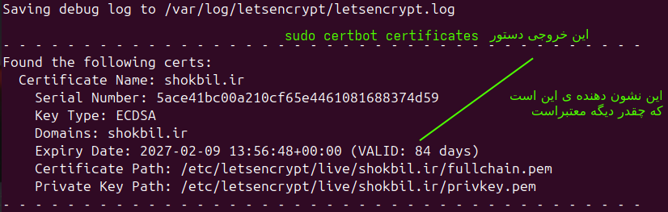

# Certificate Renewal(تمدید گواهی نامه)
---
## **۱. Certificate Renewal چیست؟**

گواهی‌های دیجیتال دارای تاریخ انقضا (Expiration Date) هستند. برای مثال، گواهی‌های Let's Encrypt معمولاً ۹۰ روز اعتبار دارند.

بنابراین باید قبل از انقضای گواهی، آن را تمدید کنیم.

در محیط Production بهتر است این فرایند به‌صورت خودکار انجام شود تا نیازی به صدور دستی Certificate در هر دوره نباشد.

---

## **۲. مراحل تمدید خودکار Certificate**

1. **Automatic Scheduling**
    
    با استفاده از Systemd Timer یا Cron، اجرای دوره‌ای Certbot را تنظیم می‌کنیم.
    
2. **Certificate Expiration Check**
    
    ا-Certbot گواهی‌های موجود را بررسی می‌کند و تشخیص می‌دهد آیا زمان تمدید آن‌ها رسیده است یا خیر.
    
3. **Domain Validation**
    
    مالکیت دامنه مجدداً از طریق ACME Challenge بررسی می‌شود. در سناریوی تو این کار با DNS-01 و Cloudflare API انجام می‌شود.
    
4. **Certificate Renewal**
    
    ا-Let's Encrypt گواهی جدید را صادر می‌کند و Certbot فایل‌های Certificate را به‌روزرسانی می‌کند.
    
5. **Deploy Hook**
    
    پس از تمدید موفق، اسکریپت موردنظر اجرا می‌شود.
    
6. **Nginx Reload**
    
    ا-Nginx گواهی جدید را بارگذاری می‌کند.

---

## **۳. پیاده‌سازی عملی با Certbot**

ما قبلاً برای `shokbil.ir` مراحل اولیه را انجام داده‌ایم.

**مرحله اول: بررسی تنظیمات Renewal**

```
sudo certbot certificates
```

این دستور گواهی‌ها و تاریخ انقضای آن‌ها را نشان می‌دهد

<p align=center>
	
</p>


**مرحله دوم: آزمایش تمدید**

```
sudo certbot renew --dry-run
```

ابتدا اجزای دستور را بررسی کنیم:

- ا-`sudo`: اجرای دستور با دسترسی کاربر Root.
    
- ا-`certbot`: اجرای ابزار مدیریت Certificate.
    
- ا-`renew`: بررسی گواهی‌های موجود و تمدید گواهی‌هایی که واجد شرایط تمدید هستند.
    
- ا-`--dry-run`: اجرای آزمایشی فرایند تمدید بدون تغییر گواهی واقعی Production.

- خروجی این دستور هم به این صورت است


<p align=center>
	
</p>

این دستور فرایند تمدید را شبیه‌سازی می‌کند و گواهی Production را تغییر نمی‌دهد.

این مرحله را با موفقیت انجام داده‌ای

---


**مرحله سوم: بررسی Automatic Timer**

```
sudo systemctl list-timers | grep certbot
```

در سیستم تو Timer فعال است و اجرای بعدی آن زمان‌بندی شده است.


---

**مرحله چهارم: ساخت Deploy Hook**

```
sudo mkdir -p /etc/letsencrypt/renewal-hooks/deploy
```

ساخت فایل:

```
sudo nano /etc/letsencrypt/renewal-hooks/deploy/reload-nginx.sh
```

محتوای فایل:

```
#!/bin/sh

if nginx -t; then
    systemctl reload nginx
fi
```

سپس:

```
sudo chmod 700 /etc/letsencrypt/renewal-hooks/deploy/reload-nginx.sh
```

این اسکریپت پس از تمدید موفق اجرا می‌شود و ابتدا صحت تنظیمات Nginx را بررسی می‌کند؛ سپس سرویس را Reload می‌کند.

---

## **۴. نقش Cloudflare API در تمدید خودکار**

نکته مهم در سناریوی تو این است که چون هنگام صدور از DNS-01 Challenge استفاده کرده‌ای، Certbot برای تمدید نیز باید بتواند به Cloudflare API دسترسی داشته باشد.

این اطلاعات در فایل زیر ذخیره شده‌اند:

```
/etc/letsencrypt/cloudflare.ini
```

و تنظیمات آن در فایل Renewal دامنه نیز ثبت شده است:

```
/etc/letsencrypt/renewal/shokbil.ir.conf
```

بنابراین نیازی نیست هر بار Token را دستی وارد کنی.

---

## **۵. معماری نهایی**

**Systemd Timer**

اجرای دوره‌ای Certbot

**Certbot Renew**

بررسی تاریخ انقضا

**Cloudflare API + DNS-01**

اعتبارسنجی دامنه

**Let's Encrypt**

صدور گواهی جدید

**Deploy Hook**

بررسی کانفیگ و Reload Nginx

---

## **۶. نکته حرفه‌ای: Renewal با Reissuance چه تفاوتی دارد؟**

- ا-**Renewal:** تمدید گواهی موجود قبل از انقضا.
    
- ا-**Reissuance:** صدور مجدد گواهی، مثلاً برای تغییر دامنه‌ها یا جایگزینی کلید.
    
- ا-**Revocation:** ابطال گواهی موجود.
    

این‌ها عملیات متفاوتی در چرخه عمر Certificate هستند.

## **تمرین نهایی برای سرور خودت**

برای اینکه مطمئن شویم تنظیمات Renewal واقعاً درست ذخیره شده‌اند، این دستور را اجرا کن:

```
sudo cat /etc/letsencrypt/renewal/shokbil.ir.conf
```

محتوای فایل را بفرست؛ فقط قبل از ارسال، هرگونه Token، رمز یا اطلاعات محرمانه احتمالی را حذف کن.

می‌خواهم بررسی کنم که Certbot هنگام تمدید خودکار دقیقاً از همان Cloudflare Plugin و فایل Credentials استفاده می‌کند یا خیر.
