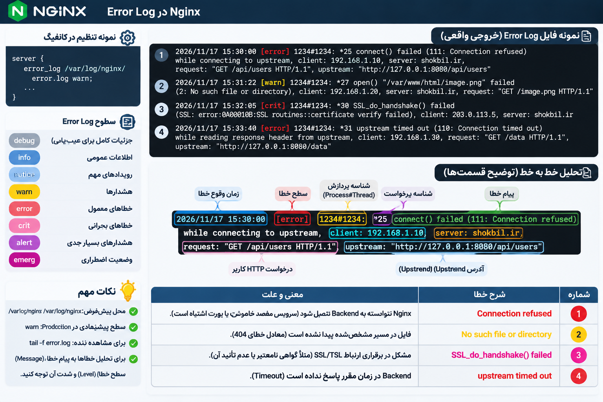

## ا-**Error Log در Nginx چیست؟**
---


دایرکتیو `error_log` برای ثبت خطاها و پیام‌های عملیاتی وب‌سرور Nginx استفاده می‌شود.

به زبان ساده، هر زمان Nginx هنگام پردازش درخواست‌ها، برقراری ارتباط با Backend، دسترسی به فایل‌ها یا اجرای تنظیمات با مشکلی مواجه شود، اطلاعات مربوط به آن را در Error Log ثبت می‌کند.

این لاگ در محیط Production برای **Troubleshooting و پیدا کردن علت مشکلات سرور** بسیار مهم است.

---

## **۱. محل تعریف در ساختار Nginx**

دایرکتیو `error_log` در چهار Context قابل استفاده است:

- `main`
    
- `http`
    
- `server`
    
- `location`
    

مثال:

```
http {

    error_log /var/log/nginx/error.log warn;

    server {
        listen 80;
        server_name shokbil.ir;

        error_log /var/log/nginx/shokbil_error.log error;

        location / {
            root /var/www/html;
        }
    }
}
```

تفاوت محل تعریف:

- در `main`: تنظیمات عمومی Nginx.
    
- در `http`: تنظیمات مربوط به HTTP و Server Blockها.
    
- در `server`: تنظیمات مربوط به یک Virtual Host.
    
- در `location`: تنظیمات مربوط به یک مسیر مشخص.
    

نکته: اگر در Context پایین‌تر `error_log` دیگری تعریف کنی، باید توجه داشته باشی که لاگ‌ها می‌توانند در چند سطح هم‌زمان فعال باشند و رفتار ارث‌بری آن با `access_log` یکسان نیست. در صورت نیاز به ثبت هم‌زمان در چند مقصد، باید هر دو مقصد را صریحاً تعریف کنی.

---
## **۲. ساختار Directive**

```
error_log /var/log/nginx/error.log warn;
```

این دستور سه بخش دارد:

|بخش|وظیفه|
|---|---|
|`error_log`|دایرکتیو ثبت خطا|
|`/var/log/nginx/error.log`|مسیر ذخیره Log|
|`warn`|سطح پیام‌های قابل ثبت|

برای غیرفعال کردن Error Log:

```
error_log off;
```

---

## **۳. سطوح مختلف Error Log**

Nginx دارای هشت سطح اصلی برای ثبت پیام‌هاست:

|Level|توضیح|
|---|---|
|`debug`|جزئیات کامل برای عیب‌یابی|
|`info`|اطلاعات عمومی|
|`notice`|رویدادهای قابل توجه|
|`warn`|هشدارها|
|`error`|خطاها|
|`crit`|خطاهای بحرانی|
|`alert`|هشدارهای بسیار جدی|
|`emerg`|وضعیت اضطراری|

نکته مهم: وقتی سطح `warn` را انتخاب می‌کنی، پیام‌های `warn` و تمام سطوح شدیدتر از آن نیز ثبت می‌شوند.

پیشنهاد Production

```
error_log /var/log/nginx/error.log warn;
```

برای بسیاری از سرورهای Production این تنظیم نقطه شروع مناسبی است.

---

## **۴. نمونه واقعی از Error Log**

فرض کن در فایل Error Log با این خط مواجه شوی:

```
2026/11/17 15:30:00 [error] 1234#1234:
*25 connect() failed (111: Connection refused)
while connecting to upstream,
client: 192.168.1.10,
server: shokbil.ir,
request: "GET /api/users HTTP/1.1",
upstream: "http://127.0.0.1:8080/api/users"
```

تحلیل:

- `2026/11/17 15:30:00`: زمان وقوع خطا
    
- ا-`[error]`: سطح خطا
    
- `1234#1234`: شناسه Process و Thread
    
- ا-`client`: آدرس IP کاربر
    
- ا-`server`: دامنه‌ای که درخواست به آن رسیده
    
- ا-`request`: درخواست HTTP کاربر
    
- ا-`upstream`: آدرس Backend
    
- ا-`Connection refused`: اتصال به Backend رد شده است.
    

یعنی کاربر درخواست `/api/users` را ارسال کرده، اما Nginx نتوانسته به Backend روی پورت 8080 متصل شود.

---

## **۵. مشاهده Error Log در Production**

مشاهده زنده خطاها:

```
sudo tail -f /var/log/nginx/error.log
```

مشاهده ۱۰۰ خط آخر:

```
sudo tail -n 100 /var/log/nginx/error.log
```

جست‌وجوی خطاهای مربوط به Backend:

```
sudo grep 'upstream' /var/log/nginx/error.log
```

---

## **۶. نمونه کانفیگ پیشنهادی برای Production**

اگر بخواهی برای هر Virtual Host لاگ اختصاصی داشته باشی:

```
server {
    listen 443 ssl;
    server_name shokbil.ir;

    access_log /var/log/nginx/shokbil_access.log;

    error_log /var/log/nginx/shokbil_error.log warn;

    # SSL Configuration
}
```

با این تنظیم، Access Log و Error Log دامنه `shokbil.ir` در فایل‌های جداگانه ذخیره می‌شوند.

**جمع‌بندی:**

|Directive|وظیفه|
|---|---|
|`access_log`|ثبت درخواست‌ها و پاسخ‌های HTTP|
|`error_log`|ثبت خطاها و پیام‌های عملیاتی Nginx|

این دو Directive پایه اصلی Logging در Nginx هستند. برای سطح Production فعلی تو، شناخت Contextها، مسیر فایل‌ها، سطوح خطا و توانایی تحلیل خروجی آن‌ها کافی است.

---
## 7-نمونه از خروجی error log
<p align=center>
	
</p>

