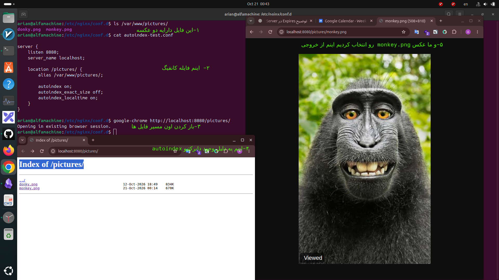

# autoindex  directive
---
## ۱-autoindex چیست؟
- ا-`autoindex` در Nginx یک Simple Directive است، نه Block Directive.

---

## ۲- در کدام بلاک ها تعریف میشه؟

- ا-`http` → اعمال تنظیمات روی تمام سرورها، مگر اینکه در سطح پایین‌تر تغییر کنه.
    
- ا-`server` → اعمال تنظیمات روی یک Virtual Server مشخص.
    
- ا-`location` → اعمال تنظیمات روی یک مسیر مشخص.

---

## ۳- مقدار هایه این دایرکتیو به چه صورته؟
این Directive دو مقدار اصلی داره:

- ا-`autoindex on;` → یعنی نمایش لیست فایل‌ها و پوشه‌های داخل دایرکتوری فعال بشه.
    
- ا-`autoindex off;` → یعنی نمایش لیست فایل‌ها و پوشه‌های داخل دایرکتوری غیرفعال بشه. این حالت پیش‌فرض Nginx است.

---


## ۴- فرایند کارش به چه صورته؟

اگر در Nginx بنویسی:

```
location /pictures/ {
    alias /var/www/pictures/;
    autoindex on;
}
```

وقتی در Chrome آدرس زیر رو باز کنی:

```
http://localhost:8080/pictures/
```

---
# بریم سراغه سناریو عملی

## سناریوی ما

1. ساخت پوشه `/var/www/pictures`
    
2. اضافه کردن چند عکس به پوشه
    
3. ساخت فایل Configuration در Nginx
    
4. فعال کردن `autoindex on;`
    
5. بررسی تنظیمات و Reload کردن Nginx
    
6. باز کردن پوشه در Chrome و مشاهده فهرست فایل‌ها
    
7. غیرفعال کردن Autoindex و مشاهده تفاوت


<p align=center>
	
</p>
# ا-autoindex یه متن هم بزرگ بالاش مینویسه که اون متنه رو اگر شما در ریشه سرور index.html تعریف کنید و در اون html یه تایتل تعریف کنید میشه اون تایتلمه

```
<title> on esme </title>
```


``


---
