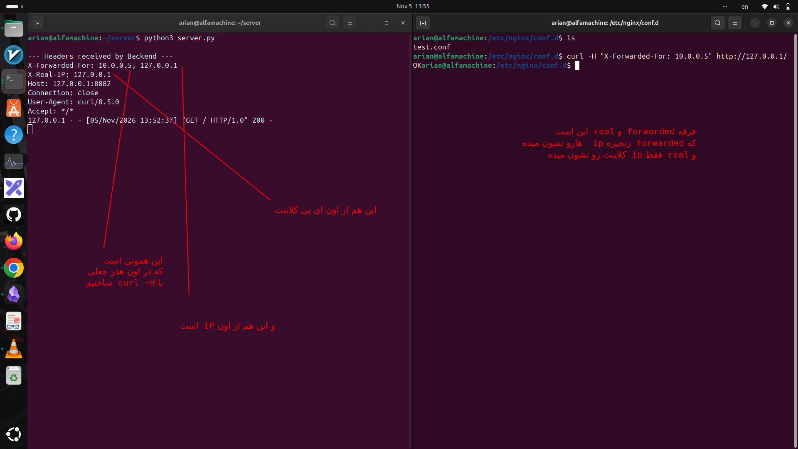

### Proxy_set_header X-Forwarded-For directive
---
## ۱-دلیل استفاده ما از این پروکسی چیست

<p align=center>
	
</p>
با استفاده از این دستور، IP کلاینت را داخل Header قرار می‌دهیم تا Backend بتواند IP واقعی کلاینت را شناسایی کند.
انتقال IP کلاینت از Nginx به Backend از طریق Header به نام `X-Forwarded-For`.

فقط یادت باشه این IP، آدرس کلاینتی است که مستقیماً به Nginx متصل شده، نه لزوماً IP کاربر نهایی در معماری‌های چندلایه

---
## ۲- فرقه بین forwarded & real IP 

## مقایسه

|ویژگی|X-Real-IP|X-Forwarded-For|
|---|---|---|
|انتقال IP کلاینت|بله|بله|
|نگهداری زنجیره IPها|خیر|بله|
|چند Proxy|فقط IP اتصال مستقیم|امکان نگهداری زنجیره|
|کاربرد|شناسایی IP مستقیم|ردیابی مسیر IPها|

## یک آزمایش جالب برای خودت

در کانفیگ Nginx هر دو رو داشته باش:

```
proxy_set_header X-Real-IP $remote_addr;
proxy_set_header X-Forwarded-For $proxy_add_x_forwarded_for;
```

حالا با curl این درخواست رو بفرست:

```
curl -H "X-Forwarded-For: 10.0.0.5" http://127.0.0.1/
```

در Backend باید ببینی:

```
X-Real-IP: 127.0.0.1
X-Forwarded-For: 10.0.0.5, 127.0.0.1
```

چرا؟

چون `$remote_addr` آدرس اتصال مستقیم رو می‌گیره، ولی `$proxy_add_x_forwarded_for` مقدار قبلی Header رو حفظ می‌کنه و IP اتصال فعلی رو به انتهای اون اضافه می‌کنه.

نکته امنیتی: این آزمایش عمداً یک IP جعلی در درخواست وارد می‌کنه تا ببینی چرا نباید بدون اعتبارسنجی به مقادیر `X-Forwarded-For` اعتماد کرد.

<p align=center>
	
</p>

---

### ۳-ما با دستور curl -H چیکار کردیم

ما با دستور `curl -H` یک هدر جعلی ساختیم، نه یک IP واقعی.

```
curl -H "X-Forwarded-For: 10.0.0.5" http://127.0.0.1/
```

اینجا به Nginx گفتیم هدر زیر را در درخواست ورودی قرار بده:

```
X-Forwarded-For: 10.0.0.5
```

اما IP واقعی اتصال همچنان `127.0.0.1` است.

بعد Nginx با این دستور:

```
proxy_set_header X-Forwarded-For $proxy_add_x_forwarded_for;
```

آدرس واقعی اتصال را به انتهای هدر اضافه می‌کند. پس بک‌اند دریافت می‌کند:

```
X-Forwarded-For: 10.0.0.5, 127.0.0.1
```

نتیجه: مقدار `10.0.0.5` را خودمان جعل کردیم؛ این دقیقاً نشان می‌دهد که نباید بدون بررسی، به مقادیر `X-Forwarded-For` اعتماد کنیم.
