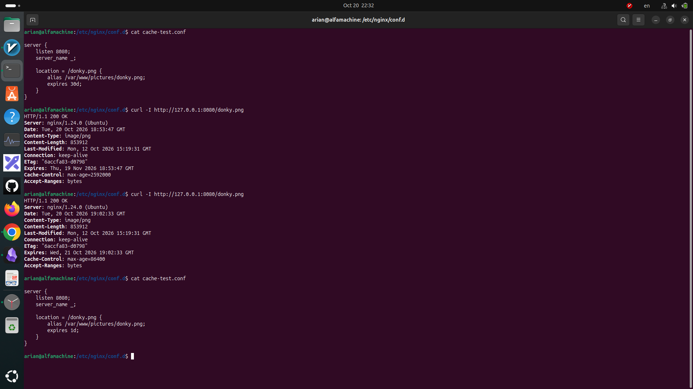
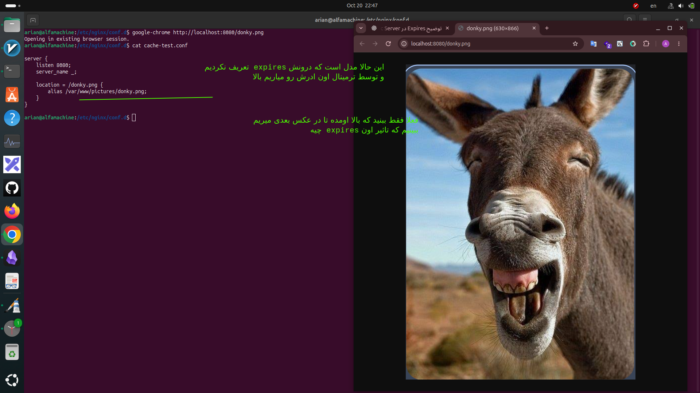
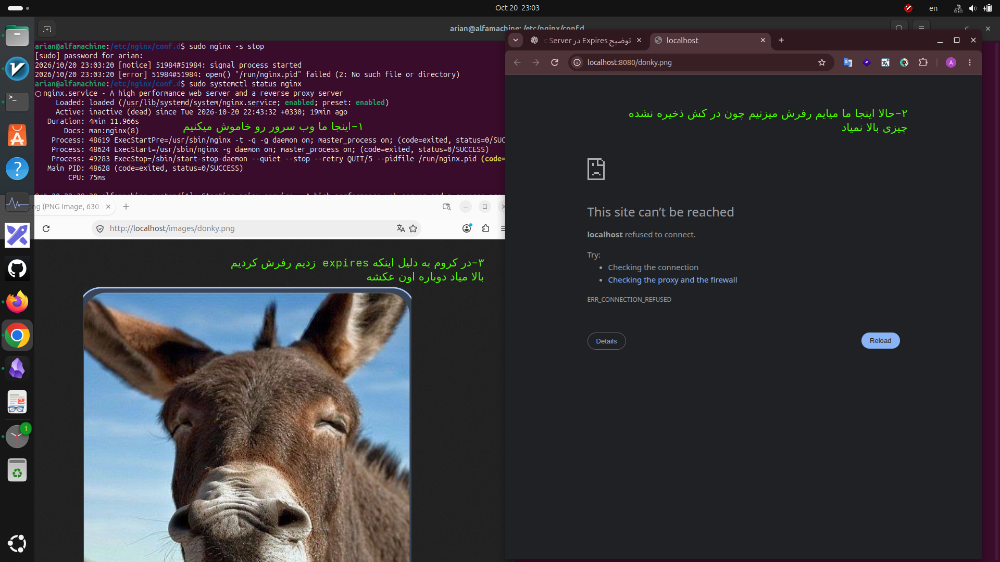

# expires directive
- چیا قراره بخونیم
- ۱-دایرکتیو expires چیست
- ۲-برایه چه فایل هایی استفاده میشه
- ۳-نمونه از این دایرکتیو درون فایل کانفیگ
- تاثیرش رویه HTTP response
- 
---
## 1-دایرکتیو expires چیست؟
دستور `expires` مشخص می‌کنه فایل‌هایی که سرور برای مرورگر ارسال می‌کنه، تا چه مدت در کش مرورگر تازه و معتبر (Fresh) باقی بمونن.

---

## 2-این دستور برایه فایل هایه استاتیک معمولا استفاده میشه یا داینامیک؟

این دستور معمولاً برای فایل‌های استاتیک استفاده می‌شه، مثل:

- تصاویر (`jpg`, `png`, `webp`)
    
- فایل‌های CSS
    
- فایل‌های JavaScript
    
- فونت‌ها (`woff`, `woff2`

---
### 3-نمونه از این دایرکتیو درون فایل کانفیگ

```
location /images/ {
    expires 30d;
}
```

یعنی فایل‌هایی که از مسیر `/images/` دریافت می‌شن، به مدت ۳۰ روز برای کش مرورگر معتبر خواهند بود.

مرورگر در این مدت معمولاً می‌تونه از نسخه ذخیره‌شده استفاده کنه و لازم نیست برای هر بار نمایش تصویر، به سرور درخواست جدید بفرسته.

---


###  4-ا-expires چه تأثیری روی HTTP Response دارد؟

وقتی در Nginx می‌نویسیم:

```
expires 7d;
```

Nginx به‌صورت خودکار دو هدر مرتبط با کش را تنظیم می‌کنه:

```
Expires: <date 7 days in the future>
Cache-Control: max-age=604800
```

دستور `expires` فقط یک مقدار داخلی نیست، بلکه مستقیماً روی هدرهای HTTP که به مرورگر ارسال می‌شن تأثیر می‌ذاره.

---
## 5- نمونه ای از مدل هایه مختلف مقادیری که میتونی به این دایرکتیو بدی

- `expires 30d;` → یعنی فایل به مدت ۳۰ روز در کش مرورگر معتبر می‌مونه.
    
- `expires 1d;` → یعنی فایل به مدت ۱ روز در کش مرورگر معتبر می‌مونه.
    
- `expires 1h;` → یعنی فایل به مدت ۱ ساعت در کش مرورگر معتبر می‌مونه.
    
- `expires 30m;` → یعنی فایل به مدت ۳۰ دقیقه در کش مرورگر معتبر می‌مونه.
    
- `expires 30s;` → یعنی فایل به مدت ۳۰ ثانیه در کش مرورگر معتبر می‌مونه.
    
- `expires 0;` → یعنی فایل بلافاصله نامعتبر (Stale) می‌شه و برای استفاده مجدد باید اعتبارش بررسی بشه.
    
- `expires -1;` → یعنی هدر `Cache-Control: no-cache` ارسال می‌شه و مرورگر قبل از استفاده مجدد باید اعتبار فایل رو بررسی کنه.
    
- `expires epoch;` → یعنی تاریخ انقضا در گذشته تنظیم می‌شه و فایل برای استفاده مجدد نیاز به اعتبارسنجی داره.
    
- `expires max;` → یعنی فایل برای حدود ۱۰ سال معتبر در نظر گرفته می‌شه.
    
- `expires off;` → یعنی Nginx با این دستور هدرهای `Expires` و `Cache-Control` رو اضافه یا تغییر نمی‌ده.
    

نکته: معتبر بودن کش یعنی مرورگر معمولاً می‌تونه بدون ارسال درخواست مجدد به سرور از فایل ذخیره‌شده استفاده کنه.

---
## بریم سراغه یه مثال که درون این مثال expires بزاریم و برسی کنیم که چی میشه


<p align=center>
	
</p>

---
## اینم یه مثال دیگه که درون این مدل بدون expires  سرو میکنیم

<p align=center>
	
</p>

----
#  اون مدل اولی رو با firefox باز کردن و مدل دومی بدون دایرکتیو expires رو با chrome

<p align=center>
	
</p>
