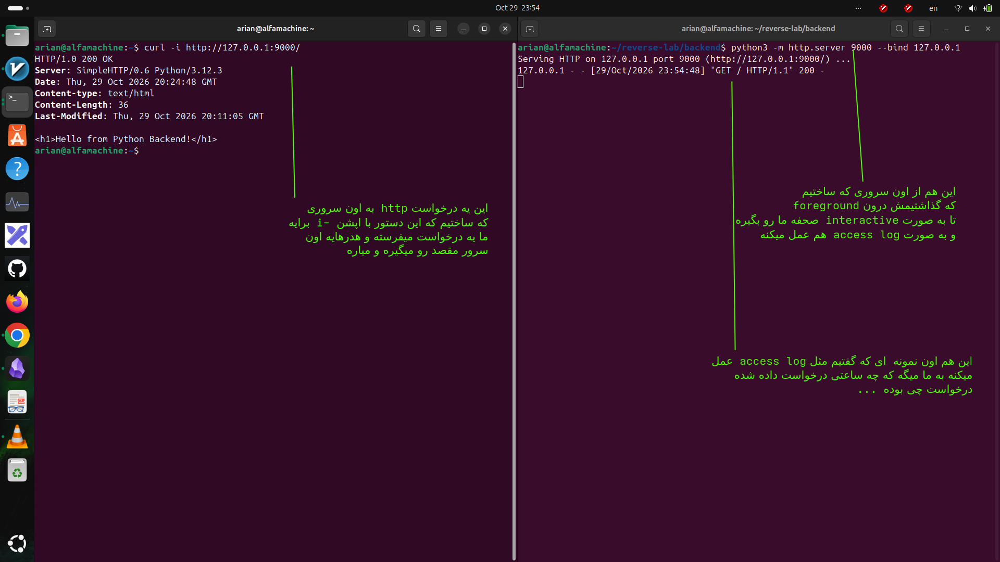
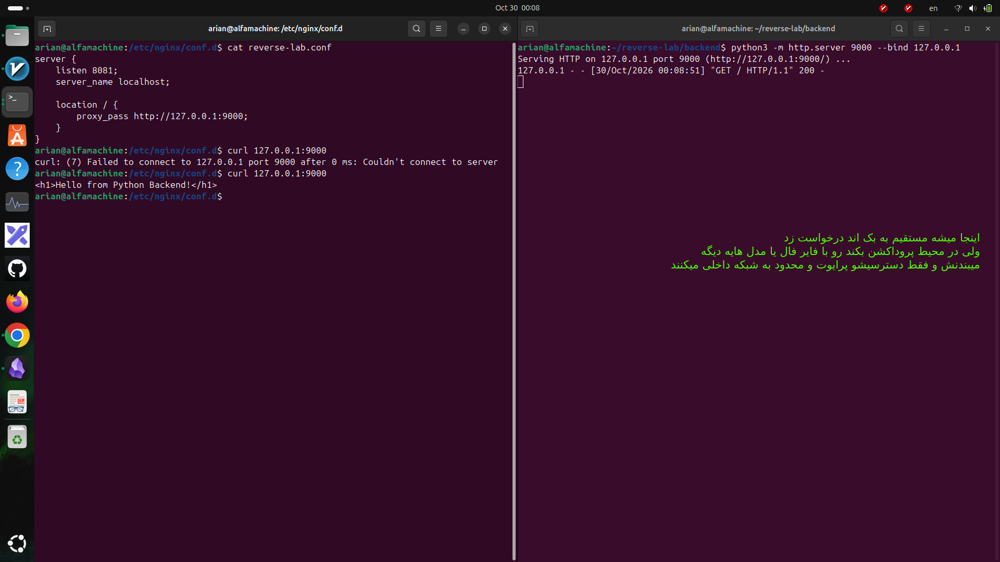
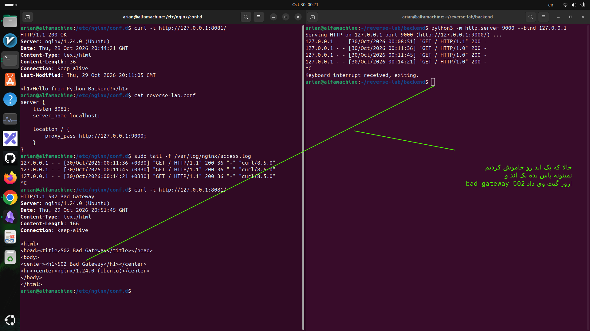

# simple proxy server 0to hundred
----
## اول قراره چیکار کنیم و هدفی که از انجام این کار داریم چیست؟

هدف: وقتی کاربر درخواست `http://localhost:8081` می‌فرسته، Nginx درخواست رو دریافت کنه، به Python روی پورت `9000` بفرسته و پاسخ رو به کاربر برگردونه.

---
## حالا بریم سراغه انجام مراحل
### ۱-ساخت پوشه پروژه
ترمینال رو باز کن و بزن:

```
mkdir -p ~/reverse-lab/backend
cd ~/reverse-lab/backend
```
- ساختارش رو اگر بخواید به صورت درختی ببنید به این صورت است
```
reverse-lab/
└── backend/
```


### ۲-ساخت فایل html
داخل پوشه `backend` این دستور رو اجرا کن:
- ما از دستور echo استفاده میکنیم
- که بیایم این مقدار رو بریزیم درون index.html و فایل جدیدی درست کنیم با این مقدار
```
echo '<h1>Hello from Python Backend!</h1>' > index.html
```
- و ساختار درختی الان پروژه به این صورت است

```
reverse-lab/
└── backend/
    └── index.html
```


### ۳- راه‌اندازی Backend با Python

هنوز داخل پوشه `backend` هستیم.

```
python3 -m http.server 9000 --bind 127.0.0.1
```
این یعنی چی python3 -m http.server 9000 --bind 127.0.0.1

| بخش دستور     | معنی                 | وظیفه                                           |
| ------------- | -------------------- | ----------------------------------------------- |
| `python3`     | اجرای پایتون نسخه ۳  | برنامه پایتون را اجرا می‌کند.                   |
| `-m`          | Module               | به پایتون می‌گوید یک ماژول را اجرا کن.          |
| `http.server` | ماژول وب‌سرور پایتون | یک وب‌سرور HTTP ساده راه‌اندازی می‌کند.         |
| `9000`        | شماره پورت           | وب‌سرور روی پورت ۹۰۰۰ گوش می‌دهد.               |
| `--bind`      | اتصال به آدرس مشخص   | تعیین می‌کند وب‌سرور روی کدام آدرس IP گوش بدهد. |
| `127.0.0.1`   | Localhost            | فقط اتصال‌های همین کامپیوتر را می‌پذیرد.        |
- یعنی چی شما میاید یه وب سرور پایتونی درست میکنید که 
- ا-IP: `127.0.0.1` یعنی فقط از همین سیستم قابل دسترسی است.
    
- ا-Port: `9000` یعنی روی این پورت منتظر درخواست‌ها می‌ماند (Listen).
    
- ا-Protocol: `HTTP` یعنی درخواست‌های HTTP را دریافت می‌کند و پاسخ می‌دهد.


اگر همه‌چیز درست باشه، می‌بینی:
- ا-<mark>میتنونیم در & بک گراند هم اجراش کنیم ولی میخوایم ببنیم که ریکوست میزنیم چی مینویسه</mark>

```
Serving HTTP on 127.0.0.1 port 9000 ...
```


### ۴- برایه تست اینکه بکندت درست کار میکنه یا نه یه رک با curl -i که مخفف include است بهش بده تا هدر هایه مربوطه رو ببینی و بعد هم بری تویه اون ترمینالی که درونش سرور پایتونی ساختی یه نگاه بندازی که ایا رکی گرفته یا نه

حالا ترمینال دوم رو باز کن و این رو بزن برایه تست:

```
curl -i http://127.0.0.1:9000/
```
باید پاسخی شبیه این ببینی

<p align=center>
	
</p> 

- حالا اگر درست باشد و سرور بکندی ساخته شده باشد در ترمینال اول این رو نشون میده
```
127.0.0.1 - - [29/Oct/2026 23:47:33] "GET / HTTP/1.1" 200 -

```
- حالا این خط چیه
- این خط در واقع یک Access Log از وب‌سرور پایتونی توست. یعنی یک کلاینت به سرورت درخواست فرستاده و سرور پاسخ داده است.

| قسمت                     | نام فنی            | معنی ساده                             |
| ------------------------ | ------------------ | ------------------------------------- |
| `127.0.0.1`              | Client IP          | آدرس IP کلاینتی که درخواست فرستاده    |
| `-`                      | Remote Identity    | اطلاعات هویت کلاینت ثبت نشده          |
| `-`                      | Authenticated User | نام کاربر احرازهویت‌شده وجود ندارد    |
| `[29/Oct/2026 23:47:33]` | Timestamp          | تاریخ و ساعت دریافت درخواست           |
| `GET`                    | HTTP Method        | کلاینت درخواست دریافت یک منبع را داده |
| `/`                      | Request Path       | مسیر ریشه وب‌سایت                     |
| `HTTP/1.1`               | HTTP Version       | نسخه پروتکل HTTP درخواست              |
| `200`                    | HTTP Status Code   | درخواست موفق بوده                     |
| `-`                      | Response Size      | اندازه پاسخ در این لاگ ثبت نشده       |


### ۵- ساخته فایل کانفیگ

حالا به Nginx می‌گیم درخواست‌هایی که روی پورت `8081` دریافت می‌کنه رو بفرسته به Backend.

فایل کانفیگ جدید:

```
sudo nano /etc/nginx/conf.d/reverse-lab.conf
```

این کد رو داخلش قرار بده:

```
server {
    listen 8081;
    server_name localhost;

    location / {
        proxy_pass http://127.0.0.1:9000;
    }
}

```

توضیح خیلی ساده Directiveها:

|Directive|وظیفه|
|---|---|
|`server`|تعریف یک Virtual Server|
|`listen 8081`|Nginx روی پورت 8081 گوش می‌ده|
|`server_name localhost`|نام هاست موردنظر|
|`location /`|همه مسیرهای سایت رو پوشش می‌ده|
|`proxy_pass`|درخواست رو به Backend می‌فرسته|

### ۶-## تست کانفیگ و Reload

```
sudo nginx -t
```

اگر دیدی:

```
syntax is ok
test is successful
```

بعد اجرا کن:

```
sudo systemctl reload nginx
```

حالا Nginx تنظیمات جدید رو بارگذاری کرده.


<p align=center>
	
</p> 


### ۷- اینجا هم دو تست اوردم که ببنیم با موفقیت ریورس پروکسی ما ست شده
- تست اول


<p align=center>
	
</p> 
- تست دوم

<p align=center>
	
</p> 

