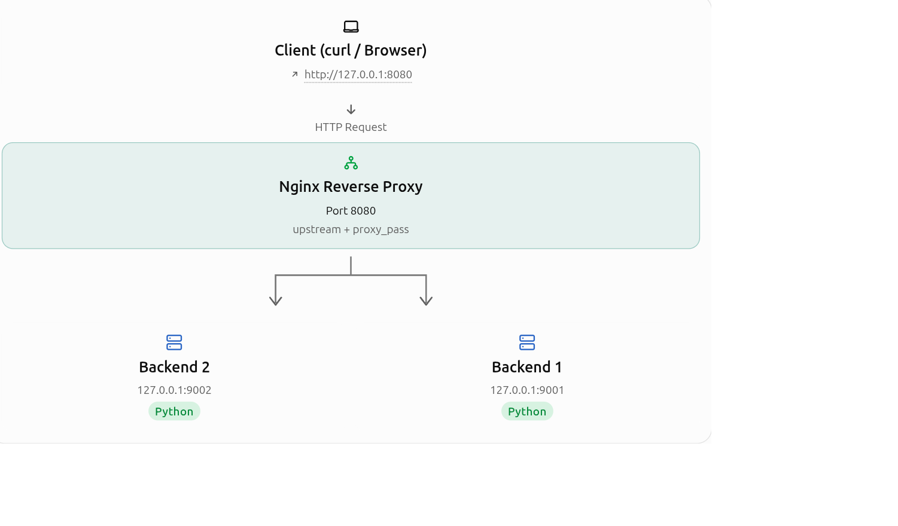
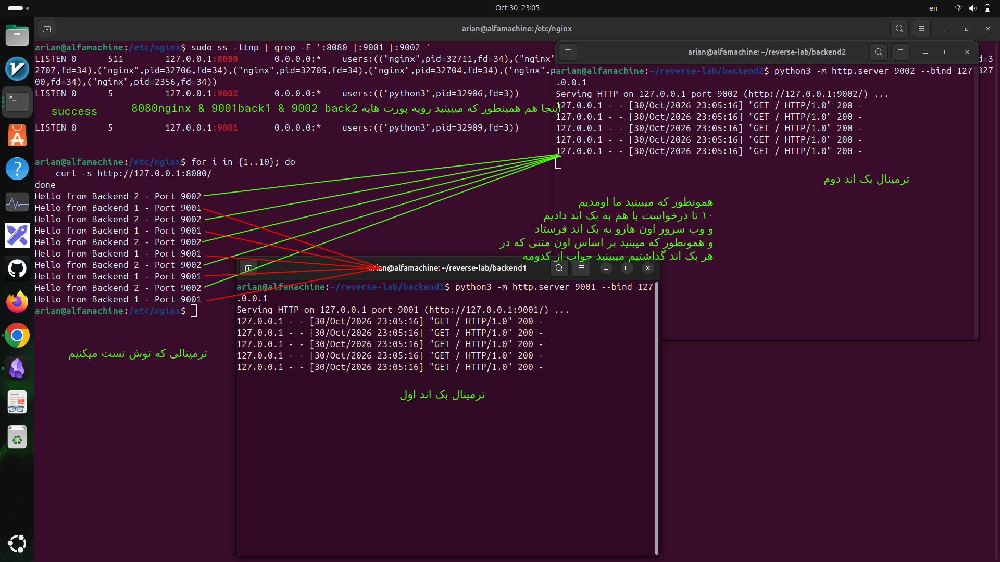
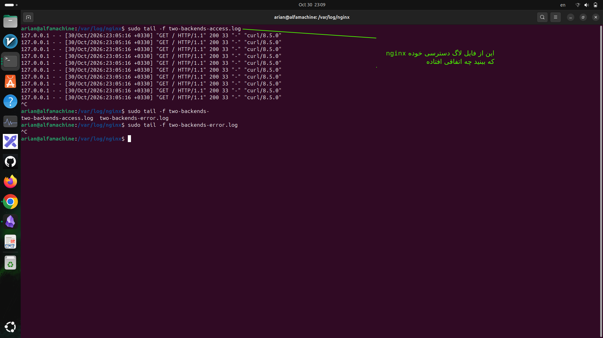

# پروژه سناریو محور :لول دوم ست کردن وب سرور انجین ایکس به عنوان reverse porxy
---
## سناریو به چه صورته:

<p align=center>
	
</p> 

```
                 CLIENT
                   |
                   | HTTP Request
                   v
                 NGINX
               Port 8080
                   |
                   | proxy_pass
                   v
          upstream my_backends
                   |
            +------+------+
            |             |
            v             v
        Backend 1     Backend 2
        Port 9001     Port 9002
            |             |
            +------+------+
                   |
                   v
                 NGINX
                   |
                   v
                 CLIENT
```
- در سناریوی ما دو Backend روی پورت‌های 9001 و 9002 گوش می‌دن (Listen) و Nginx روی پورت 8080 گوش می‌ده.

- وقتی Client به Nginx درخواست می‌فرسته، Nginx اون درخواست رو به یکی از دو Backend ارسال می‌کنه.

---

## حالا بریم سراغه درست کردن این سناریو 

#### 1- ساخت پوشه پروژه

ترمینال رو باز کن:

```
mkdir -p ~/reverse-lab/backend1
mkdir -p ~/reverse-lab/backend2
```

ساختار پروژه:

```
reverse-lab/
├── backend1/
│   └── index.html
└── backend2/
    └── index.html
```


#### 2-## ساخت فایل Backend 1

```
echo "Hello from Backend 1 - Port 9001" \
  > ~/reverse-lab/backend1/index.html
```

حالا Backend 2:

```
echo "Hello from Backend 2 - Port 9002" \
  > ~/reverse-lab/backend2/index.html
```

هر Backend پاسخ مخصوص خودش رو داره. این‌طوری می‌فهمیم Nginx به کدوم سرور درخواست داده.

#### 3-## اجرای دو Backend

ترمینال شماره 1:

```
cd ~/reverse-lab/backend1

python3 -m http.server 9001 --bind 127.0.0.1
```

ترمینال شماره 2:

```
cd ~/reverse-lab/backend2

python3 -m http.server 9002 --bind 127.0.0.1
```

هر دو ترمینال باید باز بمونن تا Python Serverها اجرا باشن.

نکته1-: <mark>پارامتر `--bind 127.0.0.1` باعث می‌شه Backend فقط روی Loopback گوش بده.</mark>
نکته 2-:<mark>اگر می‌خوای با دستور `python3 -m http.server` یک Backend ساده بسازی، بهتره داخل پوشه همون Backend باشی.</mark>
- ا-<mark>چرا؟ چون Python به‌صورت پیش‌فرض فایل‌های پوشه‌ای رو سرو می‌کنه که دستور رو از داخلش اجرا کردی.</mark>

#### 4- تست Backendها بدون Nginx

ترمینال شماره 3 رو باز کن.

```
curl -i http://127.0.0.1:9001/
```

خروجی مورد انتظار:

```
HTTP/1.0 200 OK
...
Hello from Backend 1 - Port 9001
```

و برای Backend 2:

```
curl -i http://127.0.0.1:9002/
```

باید ببینی:

```
HTTP/1.0 200 OK
...
Hello from Backend 2 - Port 9002
```

تا اینجا دو Backend مستقل داریم، اما هنوز Reverse Proxy وارد ماجرا نشده.

#### 5-ساخت کانفیگ Nginx

حالا فایل جدید رو بساز:

```
sudo nano /etc/nginx/conf.d/two-backends.conf
```

این کانفیگ رو داخلش قرار بده:

```
upstream my_backends {
    server 127.0.0.1:9001;
    server 127.0.0.1:9002;
}

server {
    listen 127.0.0.1:8080;
    server_name localhost;

    access_log /var/log/nginx/two-backends-access.log;
    error_log /var/log/nginx/two-backends-error.log;

    location / {
        proxy_pass http://my_backends;

        proxy_set_header Host $host;
        proxy_set_header X-Real-IP $remote_addr;
    }
}
```

این فایل باید از طریق `include` معمول Nginx داخل بلاک `http` بارگذاری بشه. در نصب رایج Ubuntu این ساختار وجود داره.
- ا-`proxy_pass` تعیین می‌کنه درخواست به کجا بره.
    
- ا-`proxy_set_header Host $host` مشخص می‌کنه Backend چه نام هاستی رو دریافت کنه.
    
- ا-`proxy_set_header X-Real-IP $remote_addr` اطلاعات IP اتصال ورودی به Nginx رو برای Backend ارسال

مهم‌ترین خط:

```
proxy_pass http://my_backends;
```

ی-<mark> دقت کن که اینجا به‌جای IP و Port مستقیم، اسم یک گروه رو به Nginx دادیم.</mark> در مثال اولی که زدیم در فایل قبلی ما اومدیم پورت و ای پی دادیم ولی در اینجا اسمه یه گروهه بک اندی رو دادیم


#### 6- بررسی و فعال‌سازی Nginx

اول کانفیگ رو تست کن:

```
sudo nginx -t
```

اگر صحیح بود:

```
sudo systemctl reload nginx
```

و بعد:

```
sudo ss -ltnp | grep -E ':8080 |:9001 |:9002 '
```

باید هر سه پورت رو در وضعیت `LISTEN` ببینی.


---

### حالا بریم سراغه تست تصویریش


<p align=center>
	
</p> 


- اینم از access log هایی که رویه خوده اون ترمینالایی که به عنوان سرور نشون دادیم افتاده 

---

<p align=center>
	
</p> 
-  اینم از اون مسیر هایه لاگی که در کانفیگ تعریف کردیم

