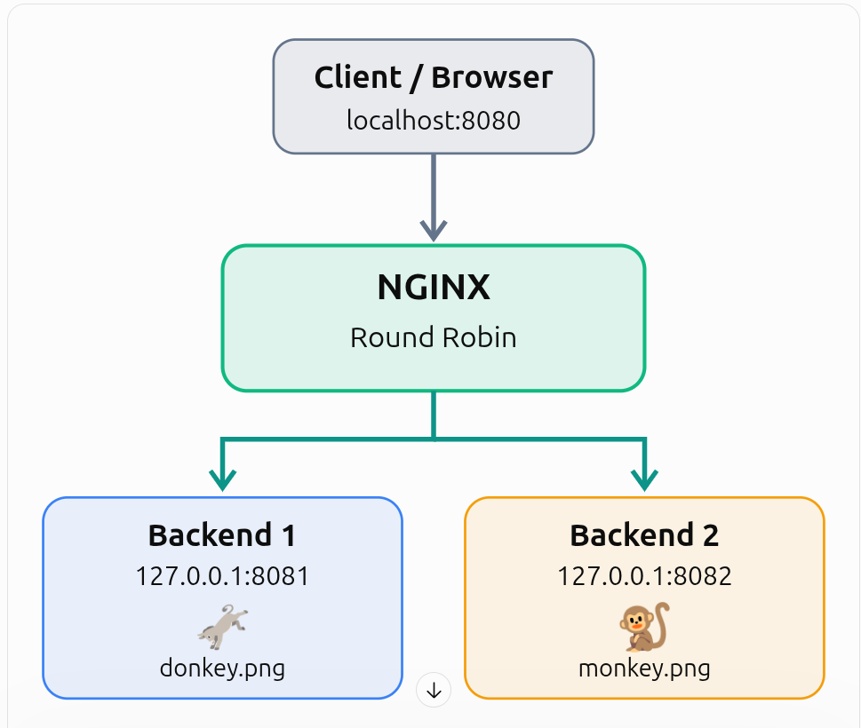
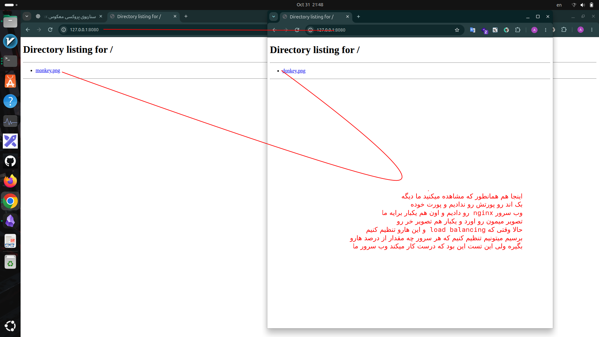

# Reverse proxy level three
---
## سناریو ما چیست؟
می‌خواهیم از صفر یک آزمایش واقعی بسازیم که در آن Nginx به‌عنوان Reverse Proxy و Load Balancer کار کند.

سناریوی ما:

- ا-Backend 1: روی پورت `8081` اجرا می‌شود و عکس `donkey.png` را نمایش می‌دهد.
    
- ا-Backend 2: روی پورت `8082` اجرا می‌شود و عکس `monkey.png` را نمایش می‌دهد.
    
- ا-Nginx: روی پورت `8080` درخواست کاربر را دریافت می‌کند و بین دو بک‌اند تقسیم می‌کند.
    
- نتیجه: با هر بار ارسال درخواست جدید، یک بک‌اند انتخاب می‌شود و تصویر مخصوص همان بک‌اند برمی‌گردد.

<p align=center>
	
</p> 

---
## حالا بریم سراغه انجام دادن این سناریو

### 1-ساخت پوشه‌های پروژه

فرض می‌کنیم Ubuntu داری و Nginx نصب شده است.

ابتدا پوشه‌ها را می‌سازیم:

```
sudo mkdir -p /data/backend1
sudo mkdir -p /data/backend2
```

ساختار نهایی و درختی پوشه بک اند ما که درون فولدر هایه سطح بالا قرار داره به این صورت میشه

```
/data/
├── backend1/
│   ├── index.html
│   └── donkey.png
│
└── backend2/
    ├── index.html
    └── monkey.png
```

برای مثال اگر عکس‌ها داخل پوشه Downloads هستند:(انتقال عکس ها به محل مربوطه)

```
sudo cp ~/Downloads/donkey.png /data/backend1/
sudo cp ~/Downloads/monkey.png /data/backend2/
```


### 3- ساخت دو Backend

فرض کن فایل‌ها در این مسیرها قرار دارند:

```
/data/backend1/donkey.png
/data/backend2/monkey.png
```

در ترمینال اول:

```
cd /data/backend1
python3 -m http.server 8081 --bind 127.0.0.1
```

در ترمینال دوم:

```
cd /data/backend2
python3 -m http.server 8082 --bind 127.0.0.1
```

حالا وضعیت ما:

|سرویس|آدرس|خروجی|
|---|---|---|
|Backend 1|`127.0.0.1:8081`|donkey|
|Backend 2|`127.0.0.1:8082`|monkey|
|Nginx|`127.0.0.1:8080`|هنوز تنظیم نشده|

<p align=center>
	
</p> 


- مدل دیگه دیدن عکسا هدر هاشون

```
curl -I http://127.0.0.1:8081/donkey.png
curl -I http://127.0.0.1:8082/monkey.png
```


### 4- تنظیم Nginx به‌عنوان Reverse Proxy

حالا به قسمت اصلی پروژه رسیدیم.

یک فایل کانفیگ مستقل می‌سازیم:

```
sudo nano /etc/nginx/conf.d/image-lab.conf
```

کد زیر را داخل آن قرار بده:


```

upstream image_backends {
    server 127.0.0.1:8081;
    server 127.0.0.1:8082;
}

server {
    listen 127.0.0.1:8080;
    server_name localhost;

    location / {
        proxy_pass http://image_backends;
        proxy_set_header Host $host;

        add_header X-Backend $upstream_addr always;
    }

    location = /donkey.png {
        proxy_pass http://127.0.0.1:8081;
    }

    location = /monkey.png {
        proxy_pass http://127.0.0.1:8082;
    }
}

```

توضیح سه بخش اصلی:

ا-`upstream image_backends` یک گروه از دو بک‌اند تعریف می‌کند.

ا-`proxy_pass http://image_backends;` درخواست‌های صفحه اصلی را به یکی از بک‌اندها می‌فرستد.

ا-`add_header X-Backend $upstream_addr always;` کمک می‌کند در پاسخ HTTP ببینیم کدام بک‌اند درخواست را پردازش کرده است.


### 5- بررسی کانفیگ و راه‌اندازی Nginx

اول:

```
sudo nginx -t
```

اگر درست باشد:

```
syntax is ok
test is successful
```

سپس:

```
sudo systemctl reload nginx
```

اگر Nginx هنوز اجرا نشده:

```
sudo systemctl start nginx
```

---
## و این هم تست نهایی که ما پورت 8080 رو میزنیم که همون پورت وب سرورمون است چیکار میکند

<p align=center>
	
</p> 
