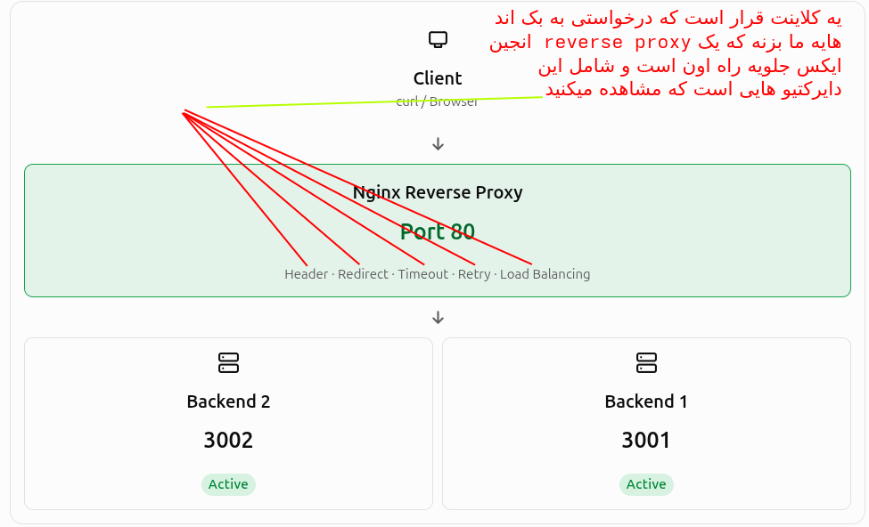
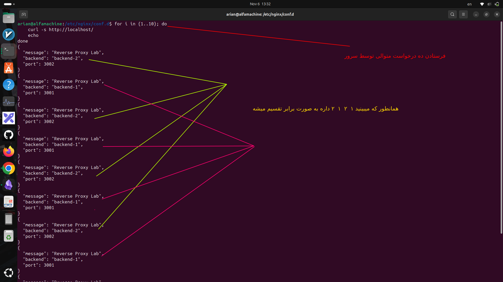

# سناریو نزدیک به محیط پروداکشن

---

## 1-اول بریم سراغه اینکه سناریو ما چیست:

سناریوی ما این است:

- یک Nginx به‌عنوان Reverse Proxy
    
- دو Backend مستقل
    
- انتقال Headerهای Client به Backend
    
- مدیریت Redirect
    
- تنظیم Timeoutها
    
- ا-Load Balancing
    
- ا-Failover در صورت بروز خطا
    
- ا-Logging برای بررسی درخواست‌ها
    

نکته مهم: این Configuration برای آزمایشگاه Ubuntu طراحی شده و بخش HTTPS و SSL را فعلاً وارد نمی‌کنیم تا بتوانیم رفتار خود Reverse Proxy را جداگانه بررسی کنیم.

---
## ۲- معماریش به چه صورته تصویری:

<p align=center>
	
</p>

---

## ۳- حالا بریم سراغه ادامه مسیر و ساخت بک اند ها و شروع کار

### ۳-۱  ساخت Backendها

ابتدا یک پوشه بساز:

```
mkdir -p ~/reverse-proxy-lab
cd ~/reverse-proxy-lab
```

یک Backend ساده با Python می‌سازیم که بتواند Headerها، Redirect، Timeout و خطاها را آزمایش کند.

فایل زیر را ایجاد کن:

`backend.py`

```

from http.server import BaseHTTPRequestHandler, HTTPServer
import json
import sys
import time

PORT = int(sys.argv[1])
BACKEND_NAME = sys.argv[2]


class BackendHandler(BaseHTTPRequestHandler):

    def send_json(self, status, data):
        body = json.dumps(data, indent=2).encode()

        self.send_response(status)
        self.send_header("Content-Type", "application/json")
        self.send_header("Content-Length", str(len(body)))
        self.end_headers()
        self.wfile.write(body)

    def do_GET(self):

        if self.path == "/":
            return self.send_json(200, {
                "message": "Reverse Proxy Lab",
                "backend": BACKEND_NAME,
                "port": PORT
            })

        if self.path == "/headers":
            return self.send_json(200, {
                "backend": BACKEND_NAME,
                "headers": dict(self.headers)
            })

        if self.path == "/redirect":
            self.send_response(302)
            self.send_header(
                "Location",
                f"http://127.0.0.1:{PORT}/landing"
            )
            self.end_headers()
            return

        if self.path == "/landing":
            return self.send_json(200, {
                "message": "Redirect successful",
                "backend": BACKEND_NAME
            })

        if self.path == "/slow":
            time.sleep(20)
            return self.send_json(200, {
                "message": "Slow response",
                "backend": BACKEND_NAME
            })

        if self.path == "/error":
            return self.send_json(500, {
                "error": "Internal Server Error",
                "backend": BACKEND_NAME
            })

        if self.path == "/health":
            return self.send_json(200, {
                "status": "healthy",
                "backend": BACKEND_NAME
            })

        return self.send_json(404, {
            "error": "Not Found",
            "path": self.path
        })

    def log_message(self, format, *args):
        print(f"[{BACKEND_NAME}] {self.address_string()} - {format % args}")


server = HTTPServer(("127.0.0.1", PORT), BackendHandler)

print(f"{BACKEND_NAME} listening on 127.0.0.1:{PORT}")

server.serve_forever()

```

- کاری اصلا به این محتوایه فایل پایتون که قراره سرور پایتونیمون رو از روش ران کنیم نداشته باشید

### ۳-۲حالا دو Backend را در دو ترمینال جداگانه اجرا کن:

Terminal 1

```
python3 backend.py 3001 backend-1
```

Terminal 2

```
python3 backend.py 3002 backend-2
```

برای اطمینان:

```
curl http://127.0.0.1:3001/
curl http://127.0.0.1:3002/
```

باید نام Backend متفاوت باشد.


### ۳-۳ ساخت فایل کانفیگ

فایل زیر را ایجاد کن:

```
sudo nano /etc/nginx/conf.d/reverse-proxy-lab.conf
```

این Configuration را داخل آن قرار بده:

```

# ==========================================
# 1. UPSTREAM / LOAD BALANCING
# ==========================================

upstream app_backend {

    # Load Balancing: Round Robin (default)

    server 127.0.0.1:3001 weight=1 max_fails=2 fail_timeout=10s;
    server 127.0.0.1:3002 weight=1 max_fails=2 fail_timeout=10s;

}


# ==========================================
# 2. LOG FORMAT
# ==========================================

log_format proxy_lab
    '$remote_addr - $host '
    '"$request" $status '
    'upstream_addr=$upstream_addr '
    'upstream_status=$upstream_status '
    'request_time=$request_time '
    'upstream_time=$upstream_response_time';


# ==========================================
# 3. SERVER
# ==========================================

server {

    listen 80;
    server_name localhost;

    access_log /var/log/nginx/proxy-lab-access.log proxy_lab;
    error_log  /var/log/nginx/proxy-lab-error.log warn;


    # ======================================
    # MAIN REVERSE PROXY
    # ======================================

    location / {

        proxy_pass http://app_backend;

        # HTTP VERSION
        proxy_http_version 1.1;

        # ==================================
        # REQUEST HEADERS
        # ==================================

        proxy_set_header Host $host;
        proxy_set_header X-Real-IP $remote_addr;
        proxy_set_header X-Forwarded-For $proxy_add_x_forwarded_for;
        proxy_set_header X-Forwarded-Proto $scheme;

        proxy_set_header Connection "";


        # ==================================
        # REDIRECT MANAGEMENT
        # ==================================

        proxy_redirect http://127.0.0.1:3001/ /;
        proxy_redirect http://127.0.0.1:3002/ /;


        # ==================================
        # TIMEOUT MANAGEMENT
        # ==================================

        proxy_connect_timeout 3s;
        proxy_send_timeout 10s;
        proxy_read_timeout 15s;


        # ==================================
        # FAILOVER / RETRY
        # ==================================

        proxy_next_upstream error timeout invalid_header http_500 http_502 http_503 http_504;

        proxy_next_upstream_tries 2;
        proxy_next_upstream_timeout 5s;


        # ==================================
        # BUFFERING
        # ==================================

        proxy_buffering on;
        proxy_buffer_size 4k;
        proxy_buffers 8 4k;

    }


    # ======================================
    # CUSTOM HEALTH ENDPOINT
    # ======================================

    location = /nginx-health {

        default_type text/plain;
        return 200 "NGINX IS RUNNING\n";

    }

}

```

چند نکته فنی درباره این Configuration:

1. `upstream` دو Backend را در یک گروه قرار داده است. توزیع درخواست‌ها در حالت عادی Round Robin است.
    
2. `proxy_set_header` اطلاعات موردنیاز Backend را منتقل می‌کند.
    
3. `proxy_redirect` آدرس Redirect داخلی هر دو Backend را بازنویسی می‌کند.
    
4. `proxy_next_upstream` شرایط تلاش مجدد روی Backend دیگر را مشخص می‌کند.
    
5. `proxy_read_timeout` حداکثر فاصله زمانی مجاز بین دو عملیات خواندن متوالی از Backend را تعیین می‌کند، نه لزوماً کل مدت پاسخ.
    
6. `max_fails` و `fail_timeout` برای تشخیص شکست‌های موقت هستند؛ این تنظیمات Health Check فعال و دائمی نیستند.
    
7. `proxy_buffering` پاسخ Backend را با استفاده از Buffer مدیریت می‌کند.
    

نکته مهم: در این سناریو هر دو Backend روی یک ماشین هستند. بنابراین `max_fails` و Failover را برای یادگیری رفتار Nginx آزمایش می‌کنیم، نه برای شبیه‌سازی کامل تحمل خرابی دو سرور مستقل

## ۳-۴ فعال‌سازی Configuration

ابتدا بررسی کن که Nginx فایل `conf.d` را Include می‌کند:

```
sudo nginx -T | grep conf.d
```

سپس Configuration را بررسی کن:

```
sudo nginx -t
```

اگر نتیجه موفق بود:

```
sudo systemctl reload nginx
```

و وضعیت سرویس:

```
sudo systemctl status nginx
```

حالا اولین درخواست را ارسال کن:

```
curl http://localhost/
```

باید یکی از Backendها پاسخ بدهد.
- پاسخ داد
```
{
  "message": "Reverse Proxy Lab",
  "backend": "backend-1",
  "port": 3001
}
```


### ۳-۵ از این قسمت میریم سراغه تست هایه مختلف
### 3-5-1 Load Balancing

ده درخواست متوالی بفرست:

```
for i in {1..10}; do
    curl -s http://localhost/ 
    echo
done
```

انتظار داریم درخواست‌ها بین دو Backend تقسیم شوند.

ا-<MARK>Round Robin به‌صورت پیش‌فرض فعال است. با وزن برابر، درخواست‌ها معمولاً به‌صورت متناوب توزیع می‌شوند.</MARK>
- ا-Round Robin یعنی اگر وزن دو سرور رو برابر تعریف کنی به صورت چرخشی تقسیم میشه بار بین دو سرور

اگر وزن دو سرور را برابر تعریف کنیم:

```
upstream app_backend {
    server 127.0.0.1:3001 weight=1;
    server 127.0.0.1:3002 weight=1;
}
```

درخواست‌ها به‌صورت چرخشی بین دو سرور توزیع می‌شوند:

<p align=center>
	
</p>


#### 3-5-2 تست دوم بررسی Headerها

```
curl -s http://localhost/headers
```

در پاسخ باید Headerهایی مشابه این ببینی:

```
{
  "Host": "localhost",
  "X-Real-IP": "127.0.0.1",
  "X-Forwarded-For": "127.0.0.1",
  "X-Forwarded-Proto": "http"
}
```

این تست برای بررسی چهار مورد زیر است:

- `proxy_set_header`
    
- `Host`
    
- `X-Real-IP`
    
- `X-Forwarded-For`
    
- `X-Forwarded-Proto`
    

نکته: چون Client و Nginx در همین ماشین هستند، IP برابر Loopback است.

### 3-5-3 تست سومRedirect

```
curl -i http://localhost/redirect
```

باید در پاسخ، چیزی مشابه این ببینی:

```
HTTP/1.1 302 Found
Location: /landing
```

حالا:

```
curl -L http://localhost/redirect
```

باید نهایتاً پاسخ `200` از مسیر `/landing` دریافت کنی.

اینجا عملکرد `proxy_redirect` را بررسی می‌کنی.

---
### 3- 5-4 تست چهارم

### Timeout

```
time curl -i http://localhost/slow
```

ا-Backend به مدت ۲۰ ثانیه منتظر می‌ماند، اما Nginx دارای این تنظیم است:

```
proxy_read_timeout 15s;
```

در نتیجه انتظار داریم پس از حدود ۱۵ ثانیه خطای `504 Gateway Timeout` ببینی.

### تست پنجم: Failover

این تست بسیار مهم است.

ابتدا Backend دوم را متوقف کن.

در ترمینالی که Backend شماره دو اجرا شده:

```
Ctrl + C
```

حالا درخواست‌های متوالی بفرست:

```
for i in {1..10}; do
    curl -s -w "\nHTTP: %{http_code}\n" http://localhost/
    sleep 1
done
```

ا-Nginx باید در صورت شکست ارتباط با Backend دوم، در محدوده تنظیمات Retry به Backend اول مراجعه کند.

توجه کن که Failover به زمان، تعداد شکست‌ها و وضعیت Upstream وابسته است. در اولین درخواست لزوماً Backend خراب از قبل غیرفعال شناخته نشده است.

### 3-5-5  تست ششم: مشاهده Logها

Access Log:

```
sudo tail -f /var/log/nginx/proxy-lab-access.log
```

Error Log:

```
sudo tail -f /var/log/nginx/proxy-lab-error.log
```

اینجا می‌توانی ببینی:

- درخواست به کدام Backend ارسال شده است.
    
- Backend چه Status Codeای داده است.
    
- مدت پاسخ چقدر بوده است.
    
- آیا Nginx به Backend دیگری مراجعه کرده است یا خیر.


