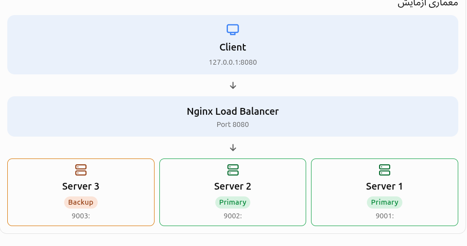

# senario for backup parameter for server directive 
---
## ۱-سناریویی که داریم چیه:

هدف آزمایش این است:

1. دو سرور اصلی داشته باشیم.
    
2. یک سرور سوم به‌عنوان Backup تعریف کنیم.
    
3. تا وقتی سرورهای اصلی فعال هستند، سرور Backup هیچ درخواستی دریافت نکند.
    
4. وقتی هر دو سرور اصلی از دسترس خارج شدند، درخواست‌ها به سرور Backup منتقل شوند.

<p align=center>
	
</p>

---

## ۲-بریم سراغه مراحلی که دارد

- ا-<mark>مرحله ۱: ساخت سه Backend Server</mark>

در ترمینال Ubuntu این دستورات را اجرا کن:

```
mkdir -p /tmp/lb-lab/{server1,server2,server3}

echo "HELLO FROM SERVER 1" > /tmp/lb-lab/server1/index.html
echo "HELLO FROM SERVER 2" > /tmp/lb-lab/server2/index.html
echo "HELLO FROM BACKUP SERVER 3" > /tmp/lb-lab/server3/index.html
```

- کاری که تا اینجا کردیم
- ۳ پوشه برایه سرور هامون ساختیم 
- در حافظه موقت رم tmp/  که باید تا الان tmp/lb-lab/ تون همچین ساختاری داشته باشد

- تا اینجا کار یه همچین ساختاری میخوایم

```
arian@alfamachine:/tmp/lb-lab$ tree .
.
├── server1
│   └── index.html
├── server2
│   └── index.html
└── server3
    └── index.html

4 directories, 3 files

```

- چرا این کار را انجام دادیم؟

چون می‌خواهیم سه Backend Server شبیه‌سازی کنیم:

- Server 1: سرور اصلی اول
    
- Server 2: سرور اصلی دوم
    
- Server 3: سرور پشتیبان یا `backup`

حالا سه سرور ساده با Python اجرا می‌کنیم:

```
nohup python3 -m http.server 9001 \
--bind 127.0.0.1 --directory /tmp/lb-lab/server1 \
>/tmp/lb1.log 2>&1 & echo $! >/tmp/lb1.pid

nohup python3 -m http.server 9002 \
--bind 127.0.0.1 --directory /tmp/lb-lab/server2 \
>/tmp/lb2.log 2>&1 & echo $! >/tmp/lb2.pid

nohup python3 -m http.server 9003 \
--bind 127.0.0.1 --directory /tmp/lb-lab/server3 \
>/tmp/lb3.log 2>&1 & echo $! >/tmp/lb3.pid
```

این سه سرور مستقل از Nginx هستند و فقط برای شبیه‌سازی Backend استفاده می‌شوند.

-  ما تا اینجا اکثرا سرور هایه پایتونی سادمون رو به صورت عادی با python3 اجرا میکردیم و الان ما سرور هامون رو با nohub که اجرا میکنیم این به این صورت است که باعث میشه که اون سرور با بسته شدن ترمینال خاموش نشه 
- ا-<mark>البته یه نکته دیگه برایه ما مهم نیست چون  در tmp درستش کردیم و رم موقته در هر صورت بعد خاموش و روشن شدن بعدی پاک میشه </mark>

- ا-<mark> مرحله ۲: تعریف upstream</mark>

فایل زیر را ایجاد کن:

```
sudo nano /etc/nginx/conf.d/backup-lab.conf
```

محتوای آن:

```
upstream lab_backend {

    server 127.0.0.1:9001;
    server 127.0.0.1:9002;

    server 127.0.0.1:9003 backup;
}

server {
    listen 8080;

    location / {
        proxy_pass http://lab_backend;
    }
}
```

به این قسمت دقت کن:

```
server 127.0.0.1:9003 backup;
```

این دقیقاً همان چیزی است که قرار است آزمایش کنیم.

- ا-<mark> مرحله ۳: تست و Reload کردن Nginx</mark>

ابتدا صحت کانفیگ را بررسی کن:

```
sudo nginx -t
```

سپس:

```
sudo systemctl reload nginx
```

- ا-<mark>مرحله ۴: بررسی حالت عادی</mark>

حالا چند درخواست به Nginx بفرست:

```
for i in {1..6}; do
    curl -s http://127.0.0.1:8080
done
```

خروجی مورد انتظار

```
HELLO FROM SERVER 1
HELLO FROM SERVER 2
HELLO FROM SERVER 1
HELLO FROM SERVER 2
HELLO FROM SERVER 1
HELLO FROM SERVER 2
```

می‌بینی که Server 1 و Server 2 درخواست‌ها را دریافت می‌کنند و Server 3 همچنان بیکار است.

- ا-<mark> مرحله ۵: از کار انداختن سرورهای اصلی</mark>

حالا می‌خواهیم هر دو سرور اصلی را خاموش کنیم:

```
kill "$(cat /tmp/lb1.pid)"
kill "$(cat /tmp/lb2.pid)"
```

سرور سوم همچنان روشن است.

حالا دوباره درخواست بفرست:

```
curl -i http://127.0.0.1:8080
```

خروجی مورد انتظار

```
HELLO FROM BACKUP SERVER 3
```

نتیجه آزمایش

ا-<mark>-Nginx متوجه شده که سرورهای اصلی در دسترس نیستند و درخواست را به سرور Backup فرستاده است.</mark>

نکته: در این آزمایش از تنظیمات پیش‌فرض `max_fails` و `fail_timeout` استفاده کردیم. بنابراین ممکن است اولین درخواست هنگام تشخیص خرابی با خطای `502` مواجه شود یا تا تکمیل تلاش‌های مجدد کمی تأخیر داشته باشد. درخواست‌های بعدی باید به Backup برسند. این رفتار به نحوه تشخیص و ثبت خرابی سرورها وابسته است.

ا-<mark>مرحله ۶: بازگرداندن سرورها</mark>

برای روشن کردن مجدد دو سرور اصلی:

```
nohup python3 -m http.server 9001 \
--bind 127.0.0.1 --directory /tmp/lb-lab/server1 \
>/tmp/lb1.log 2>&1 & echo $! >/tmp/lb1.pid

nohup python3 -m http.server 9002 \
--bind 127.0.0.1 --directory /tmp/lb-lab/server2 \
>/tmp/lb2.log 2>&1 & echo $! >/tmp/lb2.pid
```

پس از گذشت زمان تشخیص خرابی، Nginx دوباره سرورهای اصلی را وارد چرخه می‌کند و Backup به حالت انتظار برمی‌گردد.

ا-<mark>مرحله ۷: پاک‌سازی آزمایش</mark>

```
kill "$(cat /tmp/lb1.pid)" 2>/dev/null
kill "$(cat /tmp/lb2.pid)" 2>/dev/null
kill "$(cat /tmp/lb3.pid)" 2>/dev/null

sudo rm /etc/nginx/conf.d/backup-lab.conf
sudo nginx -t && sudo systemctl reload nginx
```


---
# جمع بندی این سناریو که داشتیم


پس همانطور که ما از این ازمایش دیدیم اومدیم :
- ۳ سرور در مسیر tmp/lb-lab/ ساختیم 
- که درون هر کدر اومدیم یه فایل index.html گذاشتیم که کسی که درخواست میزنه در جواب این هارو ببینه
- بعد اومدیم یه حلقه درست کردیم که دیدیم که درخواست بین سرور هایه ۱۲ تقسیم میشه چون سرور هایه اصلی primary ما هستند بعد اومدیم اون هارو down کردیم توسط pid شون که مشخص کرده بودیم در کجا ذخیره شه
- بعدش هم درخواست دادیم سرور ۳ جواب داد و ازمایش و سناریومون موفقیت امیز بود
