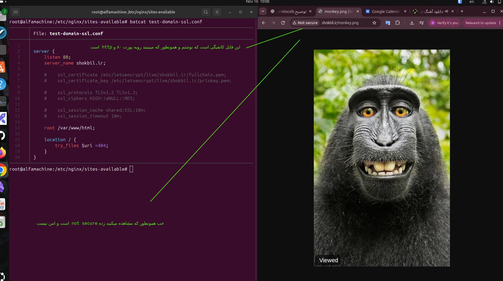

# برسی دو مدل protocol HTTPS && HTTP با کانفیگ هاشون
---
# سناریویی که :
- میخواهیم یک عکسی که در مسیر var/www/html/monkey.png رو با domain که خریده بودم به اسمه shokbil.ir در اینترنت بر رویه شبکه محلی (localhost) سرو کنیم

## نیازمندی ها:
- اشنا بودن با مفهمون name resolution یعنی اینکه بیایم درون etc/hosts/ نام دامنه رو جلو 127.0.0.1 بزاریم تا بتونیم تست سادمون رو بکنیم و 
- وقتی در فایل `/etc/hosts` می‌نویسیم:

```
127.0.0.1    shokbil.ir
```

در واقع داریم به سیستم‌عامل می‌گوییم:

**هر وقت برنامه‌ای خواست به دامنه** `shokbil.ir` **متصل شود، به‌جای اینکه IP آن را از DNS بپرسد، آدرس** `127.0.0.1` **را برایش در نظر بگیر.**

### **۱. آدرس 127.0.0.1 یعنی چه؟**

آدرس `127.0.0.1` یک آدرس Loopback است.

یعنی به خود همان کامپیوتری اشاره می‌کند که درخواست را ارسال کرده است.

---
## رفتن سراغه دیدن و برسی اینکه فرقه HTTPو HTTPS به چه صورته

- ا-<mARK> اول بریم سراغه HTTP</mark> ببینیید یه کانفیگ ساده است که فقط اومده یه عکس رو سرو کرده

<p align=center>
	
</p>
و همونطور که مشاهده میکنید در قسمت site security idicatior نشون میده که امن secure نیست

- ا-<mark> دوم بریم سراغه HTTPS</MARK> و حالا اون قسمت هایی که مربوط به SSL/TLS بود رو از کامنت در اوردیم
- برایه فعال شدن HTTPS ما ۳ قسمته خیلی مهم داریم :
- اینکه بزاریم رویه پورت 443 ssl و دوم اون دو فایل زنجیزه و کلید مخفی رو در مسیر هایی که اون certbot بهمون اون گواهی هارو داد


<p align=center>
	
</p>


---
## به این نکات هم دقت کنید

ا-`Certbot` یک نرم‌افزار (ACME Client) برای دریافت و تمدید خودکار گواهی دیجیتال از سرویس `Let's Encrypt` است.

 ا-`Let's Encrypt` **چیست؟**

`Let's Encrypt` یک سازمان صادرکننده گواهی دیجیتال (Certificate Authority) است که گواهی‌های رایگان SSL/TLS صادر می‌کند.
