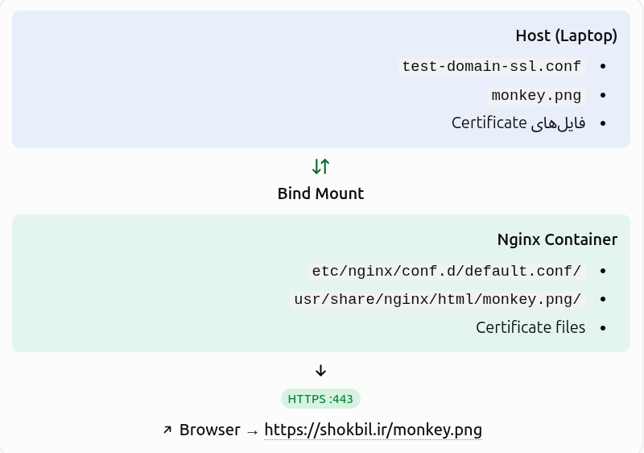

# بریم سراغه اجرا مثال فایل قبلی به همراه داکر 
---
## چیکار قراره بکنیم:

قراره یه عکس رو compose فایلی درست کنیم که درون اون بگیم nginxرو برایه ما بیاره بالا و اینکه فایل کانفیک رو از رویه هاست یا سیستم خودمون بخونه و از بایند مانت که در قسمت داکر ازش صحبت کردیم استفاده میکنیم در این قسمت و اینجا به کارمون میاد چون باید:
- فایل etc/letsencrypt/ رو مانت کنیم تویه کانتینر nginxمون

- یه فولدر به اسم nginx-docker  درست کنیم و درون یکی اون عکسه رو بزاریم و درون یکی دیگه به اسم conf.d  میایم یه فایل کانفیگ برایه nginx مون درست میکنیم و اون مانت میکنیم به مسیر اصلی که در nginx گفته شده بزارید تا include درون فایل کانفیگ اصلی یعنی قرار نیست تنظیمات Nginx را دوباره داخل Image بنویسیم.

معماری کار ما:

<p align=center>
	
</p>


---
## بریم سراغه پیاده سازی مرحله به مرحله:

- مرحله1- ساخته پوشه . اجرا کن:

```
mkdir -p ~/nginx-docker/conf.d
mkdir -p ~/nginx-docker/html
```

حالا تصویر را به پوشه پروژه منتقل کن:

```
cp /root/monkey.png ~/nginx-docker/html/
```

اگر تصویر در مسیر دیگری است، مسیر واقعی آن را جایگزین کن.

---


 **مرحله ۲. انتقال فایل کانفیگ**

فایل قبلی‌ات را که در این مسیر بود:

```
/etc/nginx/sites-available/test-domain-ssl.conf
```

به پوشه پروژه کپی کن:

```
cp /etc/nginx/sites-available/test-domain-ssl.conf \
~/nginx-docker/conf.d/default.conf
```


---
- مرحله سه  **فایل کانفیگ Nginx**

فایل را باز کن:

```
vim ~/nginx-docker/conf.d/default.conf
```

محتوای آن را به این شکل قرار بده:

```

server {
    listen 443 ssl;
    server_name shokbil.ir;

    ssl_certificate /etc/letsencrypt/live/shokbil.ir/fullchain.pem;
    ssl_certificate_key /etc/letsencrypt/live/shokbil.ir/privkey.pem;

    ssl_protocols TLSv1.2 TLSv1.3;
    ssl_ciphers HIGH:!aNULL:!MD5;

    ssl_session_cache shared:SSL:10m;
    ssl_session_timeout 10m;

    root /usr/share/nginx/html;

    location / {
        try_files $uri =404;
    }
}
```

توجه کن که مسیر `root` را به مسیر استاندارد فایل‌های وب در Container تغییر دادیم.

---
- **مرحله ۴. ساخت Docker Compose**

حالا داخل پوشه اصلی پروژه یک فایل به نام `compose.yaml` بساز:

```
cd ~/nginx-docker
vim compose.yaml
```

محتوای آن:

```

services:
  nginx:
    image: nginx:stable
    container_name: nginx-ssl
    ports:
      - "443:443"

    volumes:
      - ./conf.d/default.conf:/etc/nginx/conf.d/default.conf:ro
      - ./html:/usr/share/nginx/html:ro
      - /etc/letsencrypt:/etc/letsencrypt:ro

    restart: unless-stopped
```

حالا ببین چه اتفاقی می‌افتد:

- ا-<mark> ./اون دو فولدری هستند که درست کردیم و ..letsencrypt هم برایه اینکه سیم لینکه است کامل مانت شد</mark>

|Host|Container|
|---|---|
|`./conf.d/default.conf`|`/etc/nginx/conf.d/default.conf`|
|`./html`|`/usr/share/nginx/html`|
|`/etc/letsencrypt`|`/etc/letsencrypt`|
پارامتر `:ro` یعنی Container فقط اجازه خواندن فایل‌ها را دارد و نمی‌تواند آن‌ها را تغییر دهد.

**نکته مهم:** کل پوشه Let's Encrypt را Mount کردیم، نه فقط پوشه `live`؛ چون فایل‌های داخل `live` معمولاً Symlink به فایل‌های داخل `archive` هستند.

---
-  **مرحله ۵. بررسی وجود Certificate**

قبل از اجرای Docker، روی Host بررسی کن:

```
ls -l /etc/letsencrypt/live/shokbil.ir/
```

باید این دو فایل قابل دسترسی باشند:

```
fullchain.pem
privkey.pem
```

اگر Certificate هنوز دریافت نکرده‌ای، Nginx با این تنظیمات HTTPS بالا نمی‌آید. در آن صورت ابتدا باید گواهی را با DNS-01 دریافت کنیم.

---
-  **مرحله ۶. اجرای Nginx با Docker**

ابتدا صحت ساختار Compose را بررسی کن:

```
docker compose config
```

سپس Container را اجرا کن:

```
docker compose up -d
```

اجرای Background

پارامتر `-d` باعث می‌شود Container در پس‌زمینه اجرا شود.

وضعیت Container:

```
docker ps
```

مشاهده Logها:

```
docker logs nginx-ssl
```

---

- **مرحله ۷. تست Nginx داخل Container**

حالا می‌خواهیم مطمئن شویم Nginx فایل کانفیگ Mount شده را می‌خواند:

```
docker exec -it nginx-ssl nginx -t
```

خروجی مورد انتظار:

```
syntax is ok
test is successful
```

---

-  **مرحله ۸. تست نهایی HTTPS**

در مرورگر باز کن:

```
https://shokbil.ir/monkey.png
```

یا با ترمینال:

```
curl -Iv https://shokbil.ir/monkey.png
```


<p align=center>
	
</p>

